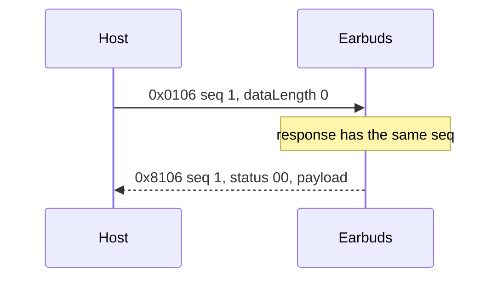
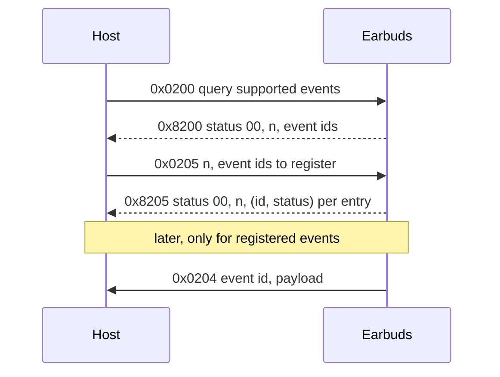
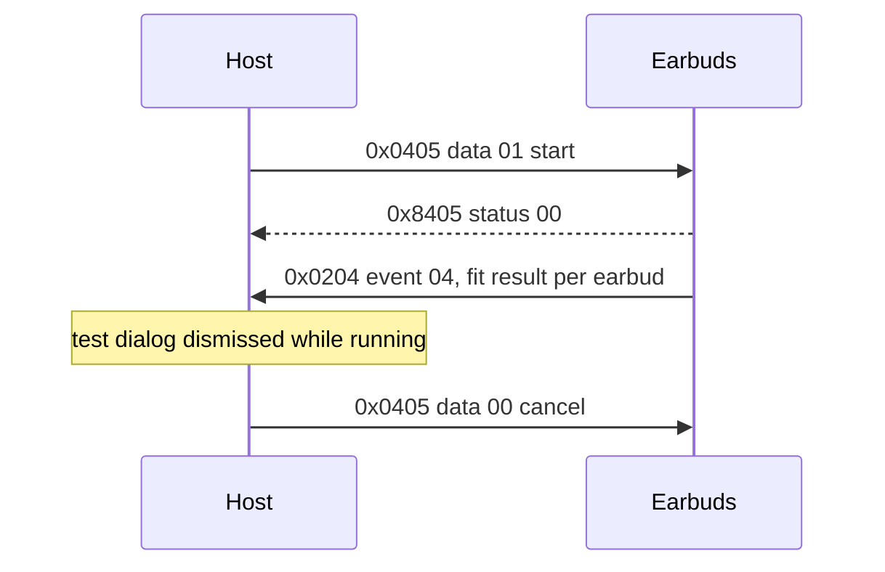
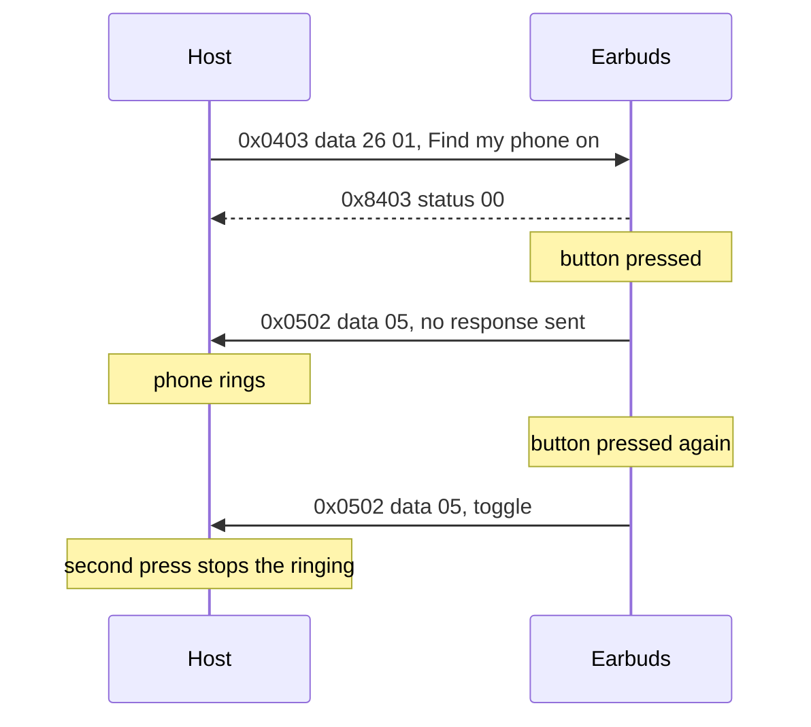
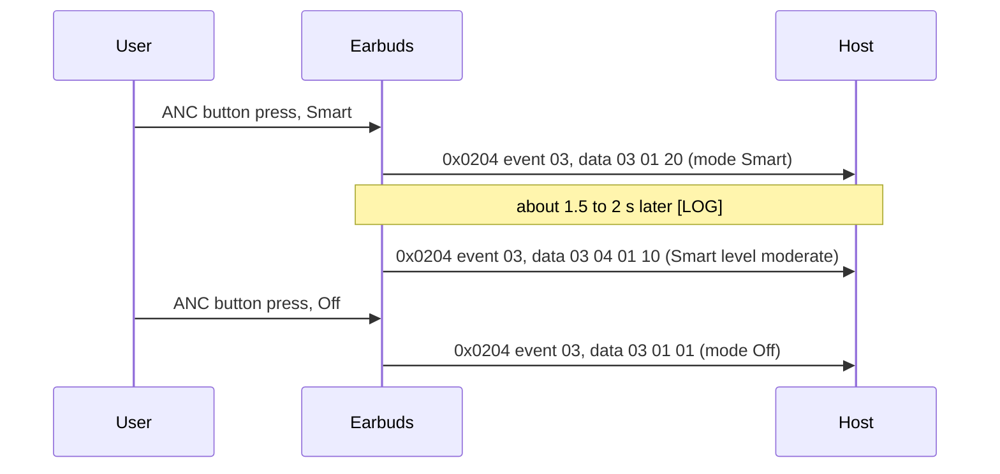

# realme Buds Wireless 5 ANC: control protocol ("tl" channel)

Sources: HCI capture (btsnoop), Frida hooks on `com.realme.link:link.monitor`, the realme Link APK
5.8.811.2814 (`com.realme.iot.headset.tl.protocol.*`) and a recorded sequence of UI actions.
None of the commands below is encrypted. Verified: the 0x0105 / 0x0106 queries from a standalone
client over RFCOMM channel 1 (battery 90 % confirmed against `0x5a`), and most of the settings
listed below from the Android app in this repository.

**Contents**

- [Conventions](#conventions)
- [Transport](#transport)
- [Frame anatomy](#frame-anatomy)
- [Frame kinds](#frame-kinds)
- [Worked examples](#worked-examples)
- [Data types](#data-types)
- [Command reference](#command-reference)
- [Events](#events)
- [Sequence diagrams](#sequence-diagrams)
- [Command index](#command-index)
- [Open items](#open-items)
  - [Resolved](#resolved)
  - [Known gaps in this repository](#known-gaps-in-this-repository)
  - [Still open](#still-open)
  - [How to capture](#how-to-capture)

## Conventions
- Hex: lowercase, two digits per byte, separated by spaces (`aa 07 00 00`).
- `u16 LE` = unsigned 16-bit, little-endian. `i8` = signed 8-bit. `MAC(6)` = six bytes of a
  Bluetooth address.
- Offsets start at 0. Frame-level tables count from the start of the frame; data-level tables
  count from `data[0]`.
- Commands are written as `0x0106`. A response to a command has the same value with bit 15 set
  (`0x8106`).
- Examples are labeled `verified` (seen in capture) or `constructed` (computed, never captured).
- Confidence legend:
  - `high`: the value matched captured traffic and its effect was checked on a real device.
  - `confirmed`: seen in a device capture.
  - `unconfirmed`: only from the APK or unverified.

## Transport
- Classic Bluetooth, RFCOMM. Channel 1 worked from the standalone client (in the phone capture the
  DLCI was 2, which corresponds to channel 1). Resolving it through SDP is safer than hardcoding it.
- Service UUIDs, tried in this order [LOG][code BudsConnection.kt]:
  1. Standard SPP: `00001101-0000-1000-8000-00805F9B34FB`
  2. Qualcomm: `0000079A-D102-11E1-9B23-00025B00A5A5`
- Observed behaviour [LOG] (OpenBuds logcat, 2026-11-07, realme Buds Wireless 5 ANC):
  - In the same log, SPP connected once and failed once ("read failed, socket might closed"); then the
    Qualcomm UUID connected.
  - After an SPP session was dropped by the earbuds ("bt socket closed, read return: -1"), the next
    connection needed the Qualcomm UUID.
  - Event registration worked on either socket (ack = true). The app registered `01 02 03 04 06 0d f1 f4`
    (not `05`); see Events.
- There is a second channel (DLCI 10, `a5 a5` frames) that exchanges 16-byte blocks. None of the
  documented commands need it.

## Frame anatomy

Frame-level offsets, counted from the start of the frame. This table assumes a one-byte `frameLength`
(see Length field for the varint rule and the two-byte case):

| offset | size | field | values / notes |
|--------|------|-------|----------------|
| 0 | 1 | `aa` start | fixed start marker |
| 1 | 1 (2 if frameLength > 127) | `frameLength` | varint of 1 or 2 bytes: 7 bits per byte, least significant first, bit 7 = another length byte follows [APK]. One-byte value: total frame size - 2. The repository's Parser decodes 1-2 bytes; `build` writes only one byte (data <= 120). See Length field |
| 2-3 | 2 | header | byte 0 = flags, byte 1 = `00`. `00 00` requests and responses; `08 00` notifications. See Header |
| 4-5 | 2 | `cmd` | u16 LE |
| 6 | 1 | `seq` | sequence number |
| 7-8 | 2 | `dataLength` | u16 LE, number of data bytes |
| 9.. | `dataLength` | data | payload |

With a two-byte `frameLength` (frameLength > 127) every field from offset 2 on shifts by one: header 3-4, `cmd` 5-6,
`seq` 7, `dataLength` 8-9, data 10.. .

Earlier revisions of this document called these fields `len` and `dlen`.

```text
+------+--------------+----------+----------+------+------------+----------------+
| aa   | frameLength* | header   | cmd      | seq  | dataLength | data           |
| 1 B  | 1 B          | 2 B      | 2 B LE   | 1 B  | 2 B LE     | dataLength     |
+------+--------------+----------+----------+------+------------+----------------+
  0      1              2 - 3      4 - 5      6      7 - 8        9 ...
  * frameLength is 2 bytes when its value is above 127; every field after it then shifts by one.
```

Fragmented frame (one-byte frameLength), see Fragmentation:

```text
+------+--------------+----------+-------+----------------------------+
| aa   | frameLength* | header   | index | payload (frameLength - 3 B)|
| 1 B  | 1 B          | 2 B      | 1 B   |                            |
+------+--------------+----------+-------+----------------------------+
  0      1              2 - 3      4       5 ...
```

Rules:
- `frameLength` vs `dataLength`: `frameLength` counts every byte after the length field (header, cmd, seq, dataLength and data).
  For a well-formed single frame with a one-byte `frameLength`, `frameLength` = `dataLength` + 7 and the whole frame is
  `dataLength` + 9 bytes. `dataLength` counts only the data bytes.
- Response: same `cmd` with bit 15 set (0x8xxx) and the same `seq`. The first data byte is the
  status (00 = OK).
- Notifications come from the earbuds unsolicited and carry their own `seq`.

### Length field

- `frameLength` is a varint [APK]: 7 bits per byte, least significant group first, bit 7 = another length
  byte follows. Encoder: `OPPOv1Wrapper` `o()` (:320-338). Decoder: `n()` (:305-318).
- Both sides assume at most two length bytes (`n > 127 ? 2 : 1`, :71 and :136) [APK]. A value of 127
  or less is one byte, identical to a plain byte.
- `frameLength` counts every byte after the length field, so the total frame size = 1 + (length-field size) + `frameLength`.
- Single frame: `frameLength` = inner packet size + 2 (the two header bytes), i.e. `dataLength` + 7 [APK].
- Fragment: `frameLength` = payload + 3 (two header bytes + one fragment index byte) [APK].

### Header

- Byte 0 = flags [APK]:
  - bits 0-1 = fragment state: 0 single frame, 1 first fragment, 2 middle, 3 last. The decoder reads
    only these bits (`byte & 3`).
  - bits `0x08` and `0x04`: set by the encoder from its two boolean arguments (`OPPOv1Wrapper` `m()`,
    :281-283). The app always passes false, so it sends `00`. What the bits mean was not traced.
  - bit `0x08` is set by the device in notifications (`08 00`) [LOG]. [INFERRED] it marks a
    device-initiated frame; the app ignores it.
- Byte 1 = constant `00` [INFERRED]. The decoder skips it, and the decompiled code at that spot is
  unclear (`OPPOv1Wrapper` :286). No meaning found.

### Fragmentation

- Maximum frame size `o` comes from the connection MTU [APK]: 512 when the MTU is unknown, class
  default 2000 otherwise (`DeviceConnectionImpl` :306-310). Product types 111 and -1 use another
  wrapper (`CommonWrapper`, `DeviceConnectionImpl` :281-292); not decoded here.
- A message is a single frame (fragment state 0) when payload <= `o` - j - 3 [APK], where `j` is the
  length-field size (`OPPOv1Wrapper` :231-303). `j` is 1 when `o` <= 129; for larger `o` it depends on
  the remaining length (exact rule in the source). For `o` = 512 and a one-byte frameLength the formula gives
  508 payload bytes. The findings give "about 507" for this case; the off-by-one is not resolved.
- Otherwise every fragment carries `o` - j - 4 payload bytes [APK]. Fragment states: first = 1,
  middle = 2, last = 3 (byte 0 bits 0-1).
- Each fragment carries a one-byte fragment index after the header; the first fragment's index is 0
  [APK]. The source wording says "fragments after the first" carry the index, but the length rule
  above (`frameLength` = payload + 3) applies to every fragment, so the first one is treated as carrying it
  too [INFERRED]; this is not confirmed on a device.
- The receive side reassembles the payload and has no size cap: it accepts whatever length the
  varint declares [APK].

### Sequence counter

- `seq` (offset 6 in a single frame) is a counter from 0 to 255, kept per device address
  (`PacketFactory.f`) [APK]. Responses echo the request's `seq`.

### Repository behaviour

- `Protocol.Parser` decodes `frameLength` as a varint of 1 or 2 bytes. A third length byte (bit 7 set on the second) invalidates the frame, and the parser resynchronises.
- `Protocol.build` writes `frameLength` as one byte and rejects data over 120 bytes (throws `IllegalArgumentException`). A one-byte varint holds 127 = 7 header bytes + 120 data bytes.
- The 2-byte encode is intentionally not implemented (YAGNI): the largest frame the app builds carries 31 data bytes (custom EQ). It will be added when a frame needs more than 120 data bytes.

### How the parser reads a stream

Derived from `Protocol.Parser`:
1. Bytes are discarded until an `aa` byte is found at the front of the buffer.
2. The parser reads `frameLength` (one or two bytes, see Length field) and waits until the whole frame is buffered: total = 1 + size of the `frameLength` field + `frameLength`. If the second length byte has bit 7 set (a third length byte, not decoded), the frame is invalid: the parser discards the `aa` byte and resynchronises (see Repository behaviour).
3. Frames with `frameLength` below 7 are consumed but not returned.
4. If `dataLength` is larger than the frame, the data is clamped to the frame end (the frame's data is
   shorter than `dataLength` says).
5. One socket read can contain several frames, and all complete frames are returned.

## Frame kinds

**Request.** Sent by the host. Header `00 00`, `cmd` is the command, `seq` is chosen by the host,
and `data` holds the request payload. A command that takes no request data sends `dataLength` 0. Byte
layouts are in Command reference and worked bytes are in Worked examples.

**Response.** Reply to a request: same `cmd` with bit 15 set, same `seq`, header `00 00`. The first
data byte is the status (`00` = OK); the rest is the payload, whose layout is given per command in
Command reference (see also Worked examples).

**Notification.** Unsolicited frame with `cmd` 0x0204 and header `08 00`, carrying its own `seq`.
`data[0]` is the event id, with no status byte, followed by the payload. The earbuds only send
notifications for events the host has registered; see Events. Worked examples shows one.

**Find-phone request.** Unsolicited frame with `cmd` 0x0502 and `data[0]` = 5 (ring). Sent when
Find my phone (0x0403 id 0x26) is on and the earbud button is pressed. It is not a 0x0204
notification: no event registration is needed and the vendor app sends no response to it. Its
header is not verified; the example in Worked examples uses `08 00` [INFERRED]. `Events.parse` decodes it into
`BudsEvent.FindPhoneRequest`; `BudsRepository` only forwards that event, and `BudsService` acts on it.

**Header differences.** Requests and responses use header `00 00`. Notifications (0x0204) use `08 00`
(bit 0x08 is set by the device) [LOG]. A fragmented message, of any kind, sets the fragment state in
byte 0 and adds a fragment index byte; see Frame anatomy. Other unsolicited frames (0x05xx) are listed
in [Unsolicited frames (0x05xx)](#unsolicited-frames-0x05xx).

## Worked examples

Each example has a title, a label, the whole frame as one line of hex, and a byte table. Offsets
count from the start of the frame (offset 0 is `aa`), so `data[0]` is at offset 9. Labels:
`verified` = seen in a capture; `constructed` = computed from the builder code, never captured.
Every example below is `constructed`; examples 8 and 9 carry payloads seen in the log. Responses are
marked `r` (for example 3r).

Consistency: `frameLength` = total frame size - 2, and `dataLength` = number of data bytes. The check table at
the end of this section confirms both for every example.

### 1. Battery query (request, `0x0106`)

Label: `constructed`

```
aa 07 00 00 06 01 01 00 00
```

| offset | bytes | field | value |
|---|---|---|---|
| 0 | aa | start marker | 0xAA |
| 1 | 07 | frameLength | 7 (total 9 - 2) |
| 2 | 00 | header lo | request |
| 3 | 00 | header hi | request |
| 4 | 06 | cmd lo | 0x0106 (QUERY_STATUS) |
| 5 | 01 | cmd hi | 0x0106 |
| 6 | 01 | seq | 1 |
| 7 | 00 | dataLength lo | 0 |
| 8 | 00 | dataLength hi | 0 |

### 2. Battery query response (`0x8106`)

Label: `constructed` (90 % = 0x5a confirmed by PROTOCOL.md)

```
aa 0b 00 00 06 81 01 04 00 00 01 01 5a
```

| offset | bytes | field | value |
|---|---|---|---|
| 0 | aa | start marker | 0xAA |
| 1 | 0b | frameLength | 11 (total 13 - 2) |
| 2 | 00 | header lo | response (header not used by parser) |
| 3 | 00 | header hi | response |
| 4 | 06 | cmd lo | 0x8106 (response bit 15 set) |
| 5 | 81 | cmd hi | 0x8106 |
| 6 | 01 | seq | 1 (echo of request) |
| 7 | 04 | dataLength lo | 4 |
| 8 | 00 | dataLength hi | 0 |
| 9 | 00 | data[0] status | OK |
| 10 | 01 | data[1] | 0x01 = n, the entry count (1) [APK] |
| 11 | 01 | data[2] | 0x01 = type, left earbud [APK] |
| 12 | 5a | data[3] | 0x5a = 90 % battery level |

### 3. setSwitchFeature: Find my phone on (`0x0403`)

Label: `constructed`

```
aa 09 00 00 03 04 02 02 00 26 01
```

| offset | bytes | field | value |
|---|---|---|---|
| 0 | aa | start marker | 0xAA |
| 1 | 09 | frameLength | 9 (total 11 - 2) |
| 2 | 00 | header lo | request |
| 3 | 00 | header hi | request |
| 4 | 03 | cmd lo | 0x0403 (SET_FEATURE) |
| 5 | 04 | cmd hi | 0x0403 |
| 6 | 02 | seq | 2 |
| 7 | 02 | dataLength lo | 2 |
| 8 | 00 | dataLength hi | 0 |
| 9 | 26 | data[0] feature id | 0x26 (Feature.FIND_MY_PHONE) |
| 10 | 01 | data[1] value | 1 = on [INFERRED, see the 0x0403 request table] |

### 3r. Response to example 3 (`0x8403`)

Label: `constructed`. Seq `0x02`, data `00` (status OK).

```
aa 08 00 00 03 84 02 01 00 00
```

| offset | bytes | field | value |
|---|---|---|---|
| 0 | aa | start marker | 0xAA |
| 1 | 08 | frameLength | 8 (total 10 - 2) |
| 2 | 00 | header lo | response |
| 3 | 00 | header hi | response |
| 4 | 03 | cmd lo | 0x8403 |
| 5 | 84 | cmd hi | 0x8403 |
| 6 | 02 | seq | 2 |
| 7 | 01 | dataLength lo | 1 |
| 8 | 00 | dataLength hi | 0 |
| 9 | 00 | data[0] status | OK |

### 4. Noise control: Max (`0x0404`)

Label: `constructed`. Data is `[action, type, value]` = `01 01 08`.

```
aa 0a 00 00 04 04 03 03 00 01 01 08
```

| offset | bytes | field | value |
|---|---|---|---|
| 0 | aa | start marker | 0xAA |
| 1 | 0a | frameLength | 10 (total 12 - 2) |
| 2 | 00 | header lo | request |
| 3 | 00 | header hi | request |
| 4 | 04 | cmd lo | 0x0404 (SET_NOISE) |
| 5 | 04 | cmd hi | 0x0404 |
| 6 | 03 | seq | 3 |
| 7 | 03 | dataLength lo | 3 |
| 8 | 00 | dataLength hi | 0 |
| 9 | 01 | data[0] action | 0x01 |
| 10 | 01 | data[1] type | 0x01 |
| 11 | 08 | data[2] value | 0x08 = Max (see Command reference, 0x0404) |

### 4r. Response to example 4 (`0x8404`)

Label: `constructed`. Seq `0x03`, data `00`.

```
aa 08 00 00 04 84 03 01 00 00
```

| offset | bytes | field | value |
|---|---|---|---|
| 0 | aa | start marker | 0xAA |
| 1 | 08 | frameLength | 8 (total 10 - 2) |
| 2 | 00 | header lo | response |
| 3 | 00 | header hi | response |
| 4 | 04 | cmd lo | 0x8404 |
| 5 | 84 | cmd hi | 0x8404 |
| 6 | 03 | seq | 3 |
| 7 | 01 | dataLength lo | 1 |
| 8 | 00 | dataLength hi | 0 |
| 9 | 00 | data[0] status | OK |

### 5. Custom EQ, update (`0x0418`)

Label: `constructed`. Input: `op` = 2 (update), `eq_id` = 4 (custom), `min` = -6 dB, `max` = +6 dB,
gains `[-6, 0, 1, 2, 3, 6]` at bands 62 / 250 / 1000 / 4000 / 8000 / 16000 Hz. Name `Custom1`.

Full frame (40 bytes, data 31 bytes = 0x1f):

```
aa 26 00 00 18 04 04 1f 00 02 fa 06 04 07 43 75 73 74 6f 6d 31 06 3e 00 fa fa 00 00 e8 03 01 a0 0f 02 40 1f 03 80 3e 06
```

| offset | bytes | field | value |
|---|---|---|---|
| 0 | aa | start marker | 0xAA |
| 1 | 26 | frameLength | 38 (total 40 - 2) |
| 2 | 00 | header lo | request |
| 3 | 00 | header hi | request |
| 4 | 18 | cmd lo | 0x0418 (SET_CUSTOM_EQ) |
| 5 | 04 | cmd hi | 0x0418 |
| 6 | 04 | seq | 4 |
| 7 | 1f | dataLength lo | 31 |
| 8 | 00 | dataLength hi | 0 |
| 9 | 02 | data[0] op | 2 = update |
| 10 | fa | data[1] min (i8) | -6 dB |
| 11 | 06 | data[2] max (i8) | +6 dB |
| 12 | 04 | data[3] eq_id | 4 = custom EQ |
| 13 | 07 | data[4] name length | 7 |
| 14 | 43 | data[5] name | 'C' |
| 15 | 75 | data[6] name | 'u' |
| 16 | 73 | data[7] name | 's' |
| 17 | 74 | data[8] name | 't' |
| 18 | 6f | data[9] name | 'o' |
| 19 | 6d | data[10] name | 'm' |
| 20 | 31 | data[11] name | '1' |
| 21 | 06 | data[12] band count | 6 |
| 22 | 3e | band 1 freq lo | 62 Hz (0x003e) |
| 23 | 00 | band 1 freq hi | |
| 24 | fa | band 1 gain | -6 (i8) |
| 25 | fa | band 2 freq lo | 250 Hz (0x00fa) |
| 26 | 00 | band 2 freq hi | |
| 27 | 00 | band 2 gain | 0 |
| 28 | e8 | band 3 freq lo | 1000 Hz (0x03e8) |
| 29 | 03 | band 3 freq hi | |
| 30 | 01 | band 3 gain | 1 |
| 31 | a0 | band 4 freq lo | 4000 Hz (0x0fa0) |
| 32 | 0f | band 4 freq hi | |
| 33 | 02 | band 4 gain | 2 |
| 34 | 40 | band 5 freq lo | 8000 Hz (0x1f40) |
| 35 | 1f | band 5 freq hi | |
| 36 | 03 | band 5 gain | 3 |
| 37 | 80 | band 6 freq lo | 16000 Hz (0x3e80) |
| 38 | 3e | band 6 freq hi | |
| 39 | 06 | band 6 gain | 6 |

### 6. Battery notification (`0x0204`, event `0x01`)

Label: `constructed`. Header `08 00` (notification), seq `0x10`. Data = event id `01`, count `01`, then one
(type, level) pair `01 46` (type 1 = left earbud, level 70 = 0x46). The layout is the battery layout of
Events [APK]; level 70 was seen in the log [LOG].

```
aa 0b 08 00 04 02 10 04 00 01 01 01 46
```

| offset | bytes | field | value |
|---|---|---|---|
| 0 | aa | start marker | 0xAA |
| 1 | 0b | frameLength | 11 (total 13 - 2) |
| 2 | 08 | header lo | notification |
| 3 | 00 | header hi | notification |
| 4 | 04 | cmd lo | 0x0204 (NOTIFY) |
| 5 | 02 | cmd hi | 0x0204 |
| 6 | 10 | seq | 16 |
| 7 | 04 | dataLength lo | 4 |
| 8 | 00 | dataLength hi | 0 |
| 9 | 01 | data[0] event id | 0x01 (EventId.BATTERY) |
| 10 | 01 | data[1] count n | 1 entry [APK] |
| 11 | 01 | data[2] type | 1 = left earbud [APK] |
| 12 | 46 | data[3] level | 70 % (`b & 0x7f`) |

### 7. Find-phone request (`0x0502`)

Label: `constructed`. The header is not verified: no capture of this frame has been decoded. The
example uses `08 00`, the header of the 0x0204 notifications [INFERRED]. The frame is unsolicited
(not a 0x0204 notification) and needs no response.

```
aa 08 08 00 02 05 20 01 00 05
```

| offset | bytes | field | value |
|---|---|---|---|
| 0 | aa | start marker | 0xAA |
| 1 | 08 | frameLength | 8 (total 10 - 2) |
| 2 | 08 | header lo | notification (not verified; `08 00` is the 0x0204 header [INFERRED]) |
| 3 | 00 | header hi | notification (not verified; `08 00` is the 0x0204 header [INFERRED]) |
| 4 | 02 | cmd lo | 0x0502 (FIND_PHONE_REQUEST) |
| 5 | 05 | cmd hi | 0x0502 |
| 6 | 20 | seq | 32 |
| 7 | 01 | dataLength lo | 1 |
| 8 | 00 | dataLength hi | 0 |
| 9 | 05 | data[0] action | 5 = ring request (toggle); no Kotlin constant (any action but `FindPhone.STOP` toggles) |

### 8. Smart ANC mode event (`0x0204`, event `0x03`, 2-byte form)

Label: `constructed` frame; payload `01 20` is [LOG]-observed. Header `08 00`, seq `0x11`. Data = event id
`03`, then `01 20` (X ignored, V = 0x20 = smart).

```
aa 0a 08 00 04 02 11 03 00 03 01 20
```

| offset | bytes | field | value |
|---|---|---|---|
| 0 | aa | start marker | 0xAA |
| 1 | 0a | frameLength | 10 (total 12 - 2) |
| 2 | 08 | header lo | notification |
| 3 | 00 | header hi | notification |
| 4 | 04 | cmd lo | 0x0204 (NOTIFY) |
| 5 | 02 | cmd hi | 0x0204 |
| 6 | 11 | seq | 17 |
| 7 | 03 | dataLength lo | 3 |
| 8 | 00 | dataLength hi | 0 |
| 9 | 03 | data[0] event id | 0x03 (EventId.NOISE) |
| 10 | 01 | data[1] X | ignored by the app |
| 11 | 20 | data[2] V | mode 0x20 = smart |

### 9. Smart ANC resolved level event (`0x0204`, event `0x03`, 3-byte form)

Label: `constructed` frame; payload `03 04 01 10` is [LOG]-observed. Header `08 00`, seq `0x12`. Data =
event id `03`, then A = `04` (resolved level), T = `01` (not read by the app), V = `10` (moderate).

```
aa 0b 08 00 04 02 12 04 00 03 04 01 10
```

| offset | bytes | field | value |
|---|---|---|---|
| 0 | aa | start marker | 0xAA |
| 1 | 0b | frameLength | 11 (total 13 - 2) |
| 2 | 08 | header lo | notification |
| 3 | 00 | header hi | notification |
| 4 | 04 | cmd lo | 0x0204 (NOTIFY) |
| 5 | 02 | cmd hi | 0x0204 |
| 6 | 12 | seq | 18 |
| 7 | 04 | dataLength lo | 4 |
| 8 | 00 | dataLength hi | 0 |
| 9 | 03 | data[0] event id | 0x03 (EventId.NOISE) |
| 10 | 04 | data[1] action A | 4 = Smart ANC resolved level |
| 11 | 01 | data[2] type T | not read by the app; meaning unknown |
| 12 | 10 | data[3] value V | 0x10 = moderate (smart_medium) |

### Check table

| example | total | frameLength byte | total - 2 | dataLength | data size | result |
|---|---|---|---|---|---|---|
| 1 | 9 | 07 | 7 | 0 | 0 | OK |
| 2 | 13 | 0b | 11 | 4 | 4 | OK |
| 3 | 11 | 09 | 9 | 2 | 2 | OK |
| 3r | 10 | 08 | 8 | 1 | 1 | OK |
| 4 | 12 | 0a | 10 | 3 | 3 | OK |
| 4r | 10 | 08 | 8 | 1 | 1 | OK |
| 5 | 40 | 26 | 38 | 31 | 31 | OK |
| 6 | 13 | 0b | 11 | 4 | 4 | OK |
| 7 | 10 | 08 | 8 | 1 | 1 | OK |
| 8 | 12 | 0a | 10 | 3 | 3 | OK |
| 9 | 13 | 0b | 11 | 4 | 4 | OK |

No mismatches.

## Data types

Encodings used by the command and event layouts. Details per command are in Command reference.

- `i8`: signed 8-bit value, two's complement. `fa` = -6, `fb` = -5, `06` = +6. The Dynamic audio
  sliders use `fb 05` for -5..+5 (see 0x041b).
- `u16 LE`: unsigned 16-bit, low byte first. 62 Hz = `3e 00`; 16000 Hz = `80 3e`. The frame `cmd`
  and `dataLength` fields use the same encoding.
- `MAC(6)`: six bytes of a Bluetooth address, in wire byte order. In the 0x0112 response the MAC is
  kept in that order (`PairedDevice.mac`); only the display text reverses it (see 0x0112).
- Bit mask: the noise-control button cycle returned by `0x010c` with request `02 01` (response
  `02 01 mask`). Bits: 0x01 = Off, 0x02 = Transparency, 0x08 = Noise cancellation.
- Length-prefixed ASCII string: `name_len` (1 byte) followed by `name_len` bytes of ASCII. Example
  from the custom EQ (example 5): `07 43 75 73 74 6f 6d 31` = `Custom1`, length 7.
- Count-prefixed list: `n` (1 byte) followed by n entries with the layout of that list. Examples:
  the 0x0112 response (`n` + device entries), the 0x0200 response (`n` + event ids), the 0x0108
  response (`n` + `[device_type, button, action, function]`), and the 0x0205 request
  (`n, id1..idn`).

## Command reference

Command ids are written as `0x....`. The earbuds answer a request with the same id plus bit 15 set
(`0x8...`) and the same `seq`. The first response data byte is the status (`00` = OK). Response
tables show the bytes after the status byte; request tables show the request data. Offsets count
from the first byte of the table's part. "repeat n times" marks an entry that repeats. In the code,
`BudsApi.query` returns the response data with the status byte included, and `readState` reads the
fields from index 1, so the status byte is skipped there, not removed.

Each command block lists: purpose, kind, Kotlin names, confidence, request layout, response layout,
hex example (if any) and notes.

### Queries (0x01xx)

#### 0x0106 battery level
- **Purpose:** battery level of the earbuds, in percent.
- **Kind:** query, request and response.
- **Kotlin:** `Cmd.QUERY_STATUS`, read by `BudsApi.readState`.
- **Confidence:** confirmed (90 % read from a standalone client on RFCOMM channel 1).
- **Request:** none (`dataLength` 0).

Response:

| offset | size | field | values / notes |
|--------|------|-------|----------------|
| offset | size | field | values / notes |
|--------|------|-------|----------------|
| 0 | 1 | n | number of entries; `01` in the captured response [APK] |
| 1 | repeat n times | entry | layout below |

Entry (offsets from the start of the entry):

| offset | size | field | values / notes |
|--------|------|-------|----------------|
| +0 | 1 | type | `01` left earbud, `02` right earbud, `03` case (box); any other value is read as left [APK] |
| +1 | 1 | level | `level & 0x7f` = battery in %; bit `0x80` = charging [APK] |

- **Captured layout:** worked example 2 (`constructed`) has the response `01 01 5a`: n = 1, type = 1
  (left), level = `5a` (90 %). [APK]
- **Hex example:** Worked examples 1 (request) and 2 (response, 90 %), label `constructed`.
- **Notes:** this app takes the lowest level among the earbud entries (types `01` and `02`), with bit `0x80`
  masked (`level and 0x7f`). The case entry (`03`) is ignored and charging is not shown. A malformed payload
  (`count` 0, shorter than `count` entries, or no earbud entry) gives no value. A status-only response (no payload
  byte after the status) also gives no value: `readState` keeps battery `null`, not 0.

#### 0x0105 firmware version text
- **Purpose:** firmware version as ASCII text.
- **Kind:** query, request and response.
- **Kotlin:** `Cmd.QUERY_VERSION`, read by `BudsApi.readState` as the firmware string.
- **Confidence:** confirmed.
- **Request:** none.

Response:

| offset | size | field | values / notes |
|--------|------|-------|----------------|
| 0 | rest of data | version | ASCII text, for example `1,2,1.1.0.56` |

- **Notes:** `readState` decodes all bytes after the status as US-ASCII.

#### 0x010c noise control mode
- **Purpose:** current noise-control mode, or the bit mask of the noise-control button cycle.
- **Kind:** query with two request forms.
- **Kotlin:** `Cmd.QUERY_NOISE`. `readState` sends both forms (`bytes(1, 1)` and `bytes(2, 1)`).
- **Confidence:** confirmed.

Request:

| offset | size | field | values / notes |
|--------|------|-------|----------------|
| 0 | 1 | form | `01` = current mode, `02` = button cycle mask |
| 1 | 1 | sub | `01` |

Response, form `01 01`:

| offset | size | field | values / notes |
|--------|------|-------|----------------|
| 0 | 2 | form echo | `01 01` |
| 2 | 1 | mode | `01` Off, `02` Transparency, `04` / `08` / `10` / `20` ANC levels |

Response, form `02 01`:

| offset | size | field | values / notes |
|--------|------|-------|----------------|
| 0 | 2 | form echo | `02 01` |
| 2 | 1 | mask | bit mask of the cycle: `01` Off, `02` Transparency, `08` Noise cancellation |

- **Notes:** the ANC level values are the same as the 0x0404 values in Settings. A status-only
  response gives no value: `readState` keeps `noise` and `cycle` as `null`, not 0.

#### 0x0112 paired devices
- **Purpose:** paired devices and their connection state.
- **Kind:** query.
- **Kotlin:** `Cmd.QUERY_PAIRED`, parsed in `BudsApi.readState` into `PairedDevice`.
- **Confidence:** confirmed.
- **Request:** none.

Response:

| offset | size | field | values / notes |
|--------|------|-------|----------------|
| 0 | 1 | n | number of entries |
| 1 | repeat n times | entry | layout below |

Entry (offsets from the start of the entry):

| offset | size | field | values / notes |
|--------|------|-------|----------------|
| +0 | 6 | MAC | Bluetooth address, in wire byte order |
| +6 | 1 | len | 3 + name_len (counts state, flag, name_len and name) |
| +7 | 1 | state | 0 disconnected, 1 connecting, 2 connected |
| +8 | 1 | flag | 1 = this device |
| +9 | 1 | name_len | length of name |
| +10 | name_len | name | device name (UTF-8 in `readState`) |

- **Notes:** the MAC is in wire byte order. `readState` copies the six bytes unchanged into
  `PairedDevice.mac`, and that value is sent back unchanged in 0x040b. Only `PairedDevice.macText`
  reverses the bytes, and only for display. The display order follows the APK / capture claim
  above and was not re-checked against a capture for this entry. `readState` stops at the first
  entry that does not fit in the payload and keeps the entries read before it.

#### 0x010f active equalizer
- **Purpose:** id of the active equalizer.
- **Kind:** query.
- **Kotlin:** `Cmd.QUERY_EQ`, read by `BudsApi.readState`.
- **Confidence:** confirmed.
- **Request:** none.

Response:

| offset | size | field | values / notes |
|--------|------|-------|----------------|
| 0 | 1 | eq id | `00`..`03` presets, `04` custom |

- **Notes:** set with 0x0406 (see Settings).

#### 0x0110 volume enhancer state
- **Purpose:** whether the volume enhancer is on.
- **Kind:** query.
- **Kotlin:** `Cmd.QUERY_VOLUME`, read by `BudsApi.readState`.
- **Confidence:** confirmed.
- **Request:** none.

Response:

| offset | size | field | values / notes |
|--------|------|-------|----------------|
| 0 | 1 | state | `00` off, `01` on |

- **Notes:** set with 0x0407 (see Settings).

#### 0x010d feature states
- **Purpose:** state of the features switched with 0x0403.
- **Kind:** query. The request lists the feature ids to read.
- **Kotlin:** `Cmd.QUERY_FEATURES`; the ids come from `BudsApi.FEATURE_IDS`; parsed by
  `BudsApi.readState`.
- **Confidence:** confirmed.

Request:

| offset | size | field | values / notes |
|--------|------|-------|----------------|
| 0 | 1 | n | number of feature ids (8 in this app) |
| 1 | n | id | feature id (see 0x0403 in Settings) |

This app sends, in order: `09 1a 1b 1d 06 08 11 26` (Enhance voices, Smart de-wind, Spatial audio,
Dynamic audio, Game mode, Auto answer, Dual-device connection, Find my phone).

Response:

| offset | size | field | values / notes |
|--------|------|-------|----------------|
| 0 | 1 | n | number of entries |
| 1 | repeat n times | entry | layout below |

Entry:

| offset | size | field | values / notes |
|--------|------|-------|----------------|
| +0 | 1 | id | feature id |
| +1 | 1 | value | `00` off, `01` on |

#### 0x0108 button functions
- **Purpose:** function assigned to each button and tap action.
- **Kind:** query.
- **Kotlin:** `Cmd.QUERY_KEYS`. The request bytes are the private `KEYS_REQUEST` in `BudsApi`.
  `readState` stores the result in `BudsState.keys`, keyed by `keyId(button, action)`.
- **Confidence:** confirmed.

Request:

| offset | size | field | values / notes |
|--------|------|-------|----------------|
| 0 | 1 | n | 14 (`0e`) |
| 1 | 14 | id | `01 03 04 05 06 0b 0c 08 0d 11 1f 1a 1b 00` (copied from the request bytes used by realme Link) |

Response:

| offset | size | field | values / notes |
|--------|------|-------|----------------|
| 0 | 1 | n | number of entries |
| 1 | repeat n times | entry | layout below |

Entry:

| offset | size | field | values / notes |
|--------|------|-------|----------------|
| +0 | 1 | device_type | not stated in the APK read |
| +1 | 1 | button | `01` multifunction, `04` noise control |
| +2 | 1 | action | `01` single tap, `02` double tap, `03` triple tap, `04` touch and hold |
| +3 | 1 | function | see 0x0401 in Settings |

#### 0x0122 equalizer list
- **Purpose:** all equalizers, including the custom one.
- **Kind:** query.
- **Kotlin:** `Cmd.QUERY_ALL_EQ`, parsed by `BudsApi.readState`. Only the entry with id 4 (custom) is
  kept, as `customEq` and `customFreqs`.
- **Confidence:** confirmed.
- **Request:** none.

Response:

| offset | size | field | values / notes |
|--------|------|-------|----------------|
| 0 | 1 | n | number of entries |
| 1 | repeat n times | entry | layout below |

Entry (offsets from the start of the entry):

| offset | size | field | values / notes |
|--------|------|-------|----------------|
| +0 | 1 | selected | not decoded |
| +1 | 1 | min | i8 |
| +2 | 1 | max | i8 |
| +3 | 1 | id | equalizer id, `4` = custom |
| +4 | 1 | name_len | length of name |
| +5 | name_len | name | ASCII |
| +5 + name_len | 1 | band_count | number of bands |
| +6 + name_len | repeat band_count times | band | layout below |

Band (3 bytes):

| offset | size | field | values / notes |
|--------|------|-------|----------------|
| +0 | 2 | freq | u16 LE, Hz |
| +2 | 1 | gain | i8 |

#### 0x012c dynamic audio sliders
- **Purpose:** the three Dynamic audio sliders.
- **Kind:** query.
- **Kotlin:** `Cmd.QUERY_DYNAMIC`, parsed by `BudsApi.readState` into a map keyed by slider type.
- **Confidence:** confirmed.
- **Request:** none.

Response:

| offset | size | field | values / notes |
|--------|------|-------|----------------|
| 0 | 1 | n | number of entries (3 sliders) |
| 1 | repeat n times | entry | layout below |

Entry:

| offset | size | field | values / notes |
|--------|------|-------|----------------|
| +0 | 1 | min | i8 |
| +1 | 1 | max | i8 |
| +2 | 1 | current | i8 |
| +3 | 1 | type | `1` low, `2` mid, `3` high |

- **Notes:** set with 0x041b (see Settings). Do not use 0x0124 (see below).

#### 0x0100 capability bitmap
- **Purpose:** bitmap of the command groups the device supports.
- **Kind:** query. This app does not send it.
- **Kotlin:** not used by this app.
- **Source:** [APK] (vendor app: PCM.C :111-118, handler PCM.l0 :838-875).
- **Confidence:** unconfirmed (APK only). The bitmap of this model has not been captured.
- **Request:** none (`dataLength` 0).

Response:

| offset | size | field | values / notes |
|--------|------|-------|----------------|
| 0 | rest | bitmask | bit i = command group `Protocol.b2[i]` is supported. Bit i is in `data[1 + i/8]`, bit `i % 8` (`data[0]` = status) [APK] |

Bit to commands (bits not listed are unassigned in the code) [APK]:

| bit | commands |
|---|---|
| 0 | 0x105 |
| 1 | 0x106 |
| 2 | 0x107 |
| 3 | 0x108, 0x401 |
| 4 | 0x109 |
| 5 | 0x400 |
| 6 | 0x402 |
| 7 | 0x10d, 0x403 |
| 8 | 0x10c, 0x404 |
| 9 | 0x405 |
| 10 | 0x406, 0x10f |
| 11 | 0x110, 0x407 |
| 13 | 0x408 |
| 14 | 0x409 |
| 15 | 0x40a, 0x111 |
| 19 | 0x40e, 0x40d, 0x115, 0x116 |
| 22 | 0x205 |
| 23 | 0xf00 |
| 25 | 0x118, 0x411 |
| 26 | 0x11a, 0x412 |
| 29 | 0x112, 0x40b |
| 30 | 0x11e, 0x11f, 0x415 |
| 32 | 0x120 |
| 34 | 0x122, 0x418 |
| 38 | 0x124, 0x41b |
| 43 | 0x41e |
| 46 | 0x128, 0x50e |
| 54 | 0x12c |
| 58 | 0x131, 0x428 |
| 60 | 0x42c |

- **Notes:** The vendor app sends this query about 50 ms after connecting, rate limited to one poll
  per 800 ms [APK]. It then runs its full device-info poll only for the groups marked as supported
  (PCM.i :729) [APK]. The bitmap of this model is an open item.

#### 0x0109 earbud wear and box state
- **Purpose:** wear state (in ear or in box) and lid state of each earbud and of the case.
- **Kind:** query.
- **Kotlin:** not used by this app.
- **Source:** [APK] (CommandUtil.f :242-259, poll handler PCM.b0 :521-542).
- **Confidence:** unconfirmed (APK only). Bit polarity is as decompiled, not verified on hardware.
- **Request:** none (`dataLength` 0).

Response:

| offset | size | field | values / notes |
|--------|------|-------|----------------|
| 0 | 1 | n | number of entries [APK] |
| 1 | repeat n times | entry | layout below |

Entry (offsets from the start of the entry):

| offset | size | field | values / notes |
|--------|------|-------|----------------|
| +0 | 1 | type | `01` left earbud, `02` right earbud, `03` case (box) [APK] |
| +1 | 1 | flags | bit 0 clear = in box (`inBox = (flags & 1) == 0`); bit 1 set = in ear; bit 2 clear = lid closed, set = lid open (passed as `coverClose`) [APK] |

- **Notes:** Same layout and same decoder as event 0x02 (see Events) [APK]. Event 0x02 was never received
  in captures, so this layout is not verified on a device.

#### 0x0115 hearing-enhancement data
- **Purpose:** hearing-enhancement data: per-entry values, a device uid and a name.
- **Kind:** query. This is not the feature-switch query (those are 0x010d and 0x0403).
- **Kotlin:** not used by this app.
- **Source:** [APK] (vendor app: PCM.Z :463-500, class HearingEnhancementInfo).
- **Confidence:** unconfirmed (APK only).
- **Request:** none stated (empty).

Response:

| offset | size | field | values / notes |
|--------|------|-------|----------------|
| 0 | 1 | ignored | not used by the decoder [APK] |
| 1 | 1 | n | number of entries [APK] |
| 2 | n entries | entries | `deviceType, type, dbValue` per entry; field sizes not stated [APK] |
| after the entries | 4 | uid | u32, big endian [APK] |
| after the uid | rest | name | text; charset not stated [APK] |

- **Notes:** The setter 0x0116 uses the matching entry layout (see below).

#### 0x0116 hearing-enhancement setter
- **Purpose:** set the hearing-enhancement data read with 0x0115.
- **Kind:** setter, request.
- **Kotlin:** not used by this app.
- **Source:** [APK] (vendor app: PCM.r :1037).
- **Confidence:** unconfirmed (APK only).

Request:

| offset | size | field | values / notes |
|--------|------|-------|----------------|
| 0 | 1 | n | number of entries [APK] |
| 1 | n entries | entries | `deviceType, type, dbValue` per entry; field sizes not stated [APK] |
| after the entries | 4 | uid | u32, big endian [APK] |

- **Response:** not stated in the APK read.

### Other queries (not used by the app)

Read from the APK's response handlers; not used by the Android app. The three blocks below take no
request data. The table after them lists more APK-only commands, some of which take request data.
All three blocks are `unconfirmed` (APK only).

#### 0x010b earbud color
- **Kind:** query. **Kotlin:** not used by the app. **Request:** none.

Response:

| offset | size | field | values / notes |
|--------|------|-------|----------------|
| 0 | 1 | color id | earbud color id |

#### 0x0107 upgrade capability
- **Kind:** query. **Kotlin:** not used by the app. **Request:** none.

Response:

| offset | size | field | values / notes |
|--------|------|-------|----------------|
| 0 | 1 | n | count |
| 1 | repeat n times | entry | 2 bytes, layout not decoded |

#### 0x0120 language setting
- **Kind:** query. **Kotlin:** not used by the app. **Request:** none.

Response:

| offset | size | field | values / notes |
|--------|------|-------|----------------|
| 0 | 1 | language | value not decoded |

Before this revision, 0x0100, 0x0109 and 0x0115 were listed as seen in traffic but not decoded. They are
now documented from the APK under Queries (0x01xx), not verified on a device. 0x0124 (single
bass-engine value) gets no response on this model; use 0x012c instead.

#### Additional APK-only queries

- **Source:** [APK] (vendor app response and poll handlers).
- **Kotlin:** not used by this app for any command below.
- **Confidence:** unconfirmed (APK only). "not stated" means the APK read does not give that field.

| cmd | what (class.method) | request | response |
|---|---|---|---|
| 0x0101 | PCM.D | `00 02` | handler `m0`, not read |
| 0x0102 | PCM.F | u16 LE `0x079a` | handler `o0`, layout not read |
| 0x0103 | PCM.E | empty | handler `n0`, layout not read |
| 0x0104 | PCM.B, sends the SDK / protocol version string (e.g. "0.0.1" style) | version string; encoding not read | handler `k0` = protocol version (:815), layout not read |
| 0x0111 | PCM.e | empty | handler `V()`, meaning unclear |
| 0x0118 | PCM, ear restore data getter | `n, ids...` | handler `c0` (handleRecvEarRestoreData), layout not read |
| 0x011a | PCM.A, getPersonalizedNoiseReductionResult | empty | handler `j0`, layout not read |
| 0x011e | PCM, getEarScanData | empty | handler not read |
| 0x011f | PCM (Protocol.b0), in the capability bitmap | not stated | handler not read |
| 0x0128 | PCM, getUseTime | not stated | handler `s0` -> UseTimeInfo list (msg 39) |
| 0x0129 | PCM.I / PCM.H, getStatusFeature | `n, featureIds...` | handler `T()`, layout not read |
| 0x012a | PCM.b, detectFeature(id) | `id` | handler `O()`, layout not read |
| 0x0131 | PCM.c, getAIState | empty | handler not read |


### Event registration (0x02xx)

The earbuds only send unsolicited notifications for the events the host has registered. The host
asks which events are supported (0x0200), registers the ones it wants (0x0205), and then receives
notifications (0x0204) for those events only. Event ids and payloads are in Events.

#### 0x0200 supported events query
- **Purpose:** list the event ids this model can send.
- **Kind:** query.
- **Kotlin:** `Cmd.QUERY_EVENTS`, parsed by `Events.parseSupported`, used by `BudsApi.registerEvents`.
- **Confidence:** confirmed.
- **Request:** none.

Response:

| offset | size | field | values / notes |
|--------|------|-------|----------------|
| 0 | 1 | n | number of event ids |
| 1 | n | id | supported event id |

- **Notes:** this model: `01 02 03 04 05 06 0d f1 f4`.
- **Hex example:** none in examples.md.

#### 0x0205 register events
- **Purpose:** register the events the host wants to receive.
- **Kind:** request and response.
- **Kotlin:** `Cmd.REGISTER_EVENTS`. The request is built by `Events.registerData` and sent by
  `BudsApi.registerEvents`, which only registers ids in `EventId.ALL`.
- **Confidence:** confirmed (the earbuds acknowledge it with OK from this app).

Request:

| offset | size | field | values / notes |
|--------|------|-------|----------------|
| 0 | 1 | n | number of event ids |
| 1 | n | id | event id to register |

Response:

| offset | size | field | values / notes |
|--------|------|-------|----------------|
| 0 | 1 | n | number of entries |
| 1 | repeat n times | entry | 2 bytes, layout below |

Entry:

| offset | size | field | values / notes |
|--------|------|-------|----------------|
| +0 | 1 | id | event id |
| +1 | 1 | status | `00` = OK |

- **Notes:** registration works from this app: query 0x0200, register the known ids with 0x0205, and
  the earbuds ack OK. The vendor app registers `01 02 03 04 05 06 f4 0d f1`.
- **Hex example:** none in examples.md.

#### 0x0204 notification
- **Purpose:** container for unsolicited events from the earbuds.
- **Kind:** notification (unsolicited, header `08 00`, carries its own `seq`).
- **Kotlin:** `Cmd.NOTIFY`, parsed by `Events.parse`.
- **Confidence:** confirmed (battery and noise-control events were seen in captures).
- **Layout:** `data[0]` = event id, with no status byte. The rest is the payload. Event ids and
  payloads are in Events.
- **Hex example:** Worked examples 6 (battery notification, `constructed`), 8 and 9 (noise-control
  events, `constructed` frames with log-observed payloads).

#### 0x0201 event registration (set)
- **Purpose:** not stated in the APK read; the APK name is `set`.
- **Kind:** not stated.
- **Kotlin:** not used by this app.
- **Source:** [APK] (vendor app: NCM :385).
- **Confidence:** unconfirmed (APK only).
- **Request:** not stated. **Response:** not stated.

#### 0x0202 register one event id
- **Purpose:** register one event id.
- **Kind:** request only in the APK read; response not stated.
- **Kotlin:** not used by this app.
- **Source:** [APK].
- **Confidence:** unconfirmed (APK only).
- **Request:** data = `id`, the event id to register.
- **Response:** not stated.
- **Notes:** The vendor app registers its ids with 0x0205, either one id at a time or all at once [APK].
  The APK read does not say whether the vendor app also sends 0x0202.

#### 0x0203 cancel registration of one event id
- **Purpose:** cancel the registration of one event id.
- **Kind:** request only in the APK read; response not stated.
- **Kotlin:** not used by this app.
- **Source:** [APK].
- **Confidence:** unconfirmed (APK only).
- **Request:** data = `id`, the event id to cancel.
- **Response:** not stated.

### Debug (0x03xx)

Debug and log-collection commands of the vendor app [APK] (DebugCommandManager; TLHCI ~818).

- **Kotlin:** not used by this app.
- **Confidence:** unconfirmed (APK only).

| cmd | what | request | response |
|---|---|---|---|
| 0x0300-0x0308 | debug / log-collection range | not stated per id | not stated |
| 0x0304 | debug command | empty | not stated |
| 0x0306 | debug command | empty | not stated |
| 0x0308 | debug command | empty | not stated |

Ids 0x0300-0x0303, 0x0305 and 0x0307 are not described in the APK read.

### Settings (0x04xx)

Commands that change the earbuds' settings. The response has the same command id with bit 15 set
and the same `seq`. Unless a command says otherwise, the response payload is the status byte only
(`00` = OK); this app checks the status and reads no further bytes (`BudsApi.send`).

#### 0x0403 setSwitchFeature
- **Purpose:** switch one feature on or off.
- **Kind:** setter, request and response.
- **Kotlin:** `Cmd.SET_FEATURE`, feature ids in `Feature`; builder `BudsApi.setFeature(id, on)`.
- **Confidence:** high for every id in the first table below; unconfirmed for the APK-only ids.

Request:

| offset in data | size | field | values / notes |
|---|---|---|---|
| 0 | 1 | feature id | see the table below |
| 1 | 1 | value | `01` on [INFERRED: same `1 = on` convention as the event 0x05 payload, see Events], `00` off |

Feature ids:

| id | function | Kotlin | confidence |
|---|---|---|---|
| 0x1a | Smart de-wind technology | `Feature.SMART_DEWIND` | high |
| 0x09 | Enhance voices | `Feature.ENHANCE_VOICES` | high |
| 0x1b | Spatial audio | `Feature.SPATIAL_AUDIO` | high |
| 0x1d | Dynamic audio | `Feature.DYNAMIC_AUDIO` | high |
| 0x06 | Game mode | `Feature.GAME_MODE` | high |
| 0x11 | Dual-device connection | `Feature.DUAL_CONNECTION` | high |
| 0x26 | Find my phone | `Feature.FIND_MY_PHONE` | high |
| 0x08 | Auto answer | `Feature.AUTO_ANSWER` | high |

Other feature ids that the vendor app uses with 0x0403 / 0x0129 [APK]. The ids above that are
already named are not repeated; the table below lists the ones the APK read did not name:

| id | function | Kotlin | confidence |
|---|---|---|---|
| 0x04 | unknown (not named in the APK read) | not used by this app | unconfirmed (APK only) |
| 0x05 | unknown (not named in the APK read) | not used by this app | unconfirmed (APK only) |
| 0x07 | unknown (not named in the APK read) | not used by this app | unconfirmed (APK only) |
| 0x0b | unknown (not named in the APK read) | not used by this app | unconfirmed (APK only) |
| 0x0c | unknown (not named in the APK read) | not used by this app | unconfirmed (APK only) |
| 0x13 | unknown (not named in the APK read) | not used by this app | unconfirmed (APK only) |
| 0x18 | unknown (not named in the APK read) | not used by this app | unconfirmed (APK only) |
| 0x36 | unknown (not named in the APK read) | not used by this app | unconfirmed (APK only) |

- **Source:** [APK] feature ids of `PCM.w0` (lines 54-101 of the decompiled code); the ids that are
  named above were also seen there. Ids not in either table are unknown.
- Id `0x06` (game mode) is also reported by event `0x05` [APK]: payload byte 0 = `01` means on, any
  other value means off. This app does not register event 0x05 (see Events).

Response: status byte only.

- **Hex example:** Worked examples 3 (request, `constructed`) and 3r (response, `constructed`):
  `aa 09 00 00 03 04 02 02 00 26 01` and `aa 08 00 00 03 84 02 01 00 00`.
- **Notes:** Find my phone (0x26): while enabled, pressing the earbud button makes the earbuds send an
  unsolicited `cmd 0x0502` with data[0] = 5, and the app rings the phone. The ring has no timeout and
  stops when the button is pressed four times again [USER]. See 0x0502 under Unsolicited frames
  (0x05xx). Feature states are read with 0x010d.

#### 0x0404 noise control
- **Purpose:** set the noise-control mode (action `01`), or the bit mask of the button cycle (action
  `02`).
- **Kind:** setter, two forms, request and response.
- **Kotlin:** `Cmd.SET_NOISE`; `BudsApi.setNoise(mode)` for action `01`, `BudsApi.setNoiseCycle(mask)`
  for action `02`. Mode values are in `Noise`, mask bits in `CycleBit`.
- **Confidence:** not stated in the original text. The mode values below are [APK] (see the notes
  after the table); raw `01` (off) also matches [LOG].

Request:

| offset in data | size | field | values / notes |
|---|---|---|---|
| 0 | 1 | action | `01` set mode, `02` set button cycle mask |
| 1 | 1 | type | `01` |
| 2 | 1 | value | mode (action `01`) or mask (action `02`) |

Mode values (action `01`):

| value | mode | Kotlin |
|---|---|---|
| 01 | Off (normal) | `Noise.NORMAL` |
| 02 | Transparency | `Noise.TRANSPARENT` |
| 04 | Mild | `Noise.MILD` |
| 08 | Max | `Noise.MAX` |
| 10 | Moderate | `Noise.MODERATE` |
| 20 | Smart | `Noise.SMART` |

- **Raw values, verified result [APK]:** `01` normal (off), `02` transparency, `04` mild, `08` max
  (noise cancellation on), `10` moderate, `20` smart. The same raw set is used by event 0x03 (see
  Events). [LOG] An ANC button press to Off produced the event payload `01 01` (raw `01`).
- **Vendor app mapping [APK]:** reading the raw value (TLHCI:453) maps raw to the vendor app's own
  value: `01` -> 2 (default), `02` -> 4 (transparency), `04` -> 8 (light), `08` -> 1 (deep),
  `10` -> 16 (medium), `20` -> 32 (smart); any other raw value -> 0. Writing uses the inverse mapping
  (TLHCI:1180-1225, SCM:62-67). So app value 1 = raw `08` and app value 8 = raw `04`.

Mask bits (action `02`, the modes in the noise-control button cycle):

| bit | mode | Kotlin |
|---|---|---|
| 01 | Off | `CycleBit.OFF` |
| 02 | Transparency | `CycleBit.TRANSPARENCY` |
| 08 | Noise cancellation | `CycleBit.NOISE_CANCELLATION` |

Response: status byte only.

- **Hex example:** Worked examples 4 (request, `constructed`; data `01 01 08` = Max) and 4r
  (response, `constructed`): `aa 0a 00 00 04 04 03 03 00 01 01 08` and `aa 08 00 00 04 84 03 01 00 00`.
- **Notes:** The order in the capture (20, 08, 10, 04, 08) matches the order the levels were selected
  in the vendor app. The current mode and the cycle mask are read with 0x010c.

#### 0x0405 fit test
- **Purpose:** start the earbud fit test, or cancel it.
- **Kind:** setter, request and response.
- **Kotlin:** `Cmd.FIT_TEST`; `BudsApi.fitTest(start)`.
- **Confidence:** high.

Request:

| offset in data | size | field | values / notes |
|---|---|---|---|
| 0 | 1 | action | `01` start, `00` cancel |

Response: status byte only.

- **Notes:** The result arrives as fit-test event 0x04 (see Events). When the vendor app's test
  dialog is dismissed while a test is running, it sends `0x0405 00`; this app does the same.

#### 0x0406 EQ preset
- **Purpose:** select a preset equalizer.
- **Kind:** setter, request and response.
- **Kotlin:** `Cmd.SET_EQ`, values in `Eq`; `BudsApi.setEq(preset)`.
- **Confidence:** high.

Request: one byte, the preset id.

| value | preset | Kotlin |
|---|---|---|
| 00 | Nature balance | `Eq.NATURE_BALANCE` |
| 01 | Bass boost | `Eq.BASS_BOOST` |
| 02 | Clear vocals | `Eq.CLEAR_VOCALS` |
| 03 | Clear bass | `Eq.CLEAR_BASS` |

Response: status byte only.

- **Notes:** Setting a preset with 0x0406 switches back to a preset without erasing the custom values
  (see 0x0418). The active id is read with 0x010f.

#### 0x0407 volume enhancer
- **Purpose:** turn the volume enhancer on or off.
- **Kind:** setter, request and response.
- **Kotlin:** `Cmd.SET_HIGH_VOLUME`; `BudsApi.setHighVolume(on)`.
- **Confidence:** high.

Request:

| offset in data | size | field | values / notes |
|---|---|---|---|
| 0 | 1 | state | `01` on, `00` off |

Response: status byte only.

- **Notes:** The state is read with 0x0110.

#### 0x040b dual-device action
- **Purpose:** connect, disconnect or remove one device of the dual-device list.
- **Kind:** setter, request and response.
- **Kotlin:** `Cmd.SET_MULTI_CONNECT`; `BudsApi.multiConnect(mac, action)`.
- **Confidence:** high.

Request:

| offset in data | size | field | values / notes |
|---|---|---|---|
| 0 | 1 | fixed | `01` (this app always sends it; meaning unknown) |
| 1 | 6 | MAC(6) | device address in protocol byte order (as in the 0x0112 entry) |
| 7 | 1 | action | `00` disconnect (not tested by this app), `01` connect, `02` remove |

Response: status byte only, but it can arrive late.

- **Notes:** The 0x840b response with data `00` can take more than 2 s. Use a longer timeout; this app
  uses 10 s.

#### 0x0418 custom equalizer
- **Purpose:** create, update or confirm the custom equalizer (eq id 4).
- **Kind:** setter, request and response.
- **Kotlin:** `Cmd.SET_CUSTOM_EQ`; `BudsApi.createCustomEq(freqs)` (op 1) and
  `BudsApi.updateCustomEq(gains, freqs)` (op 2). The payload is built by `Protocol.customEqData`.
  No builder in this app sends op 3.
- **Confidence:** high.

Request:

| offset in data | size | field | values / notes |
|---|---|---|---|
| 0 | 1 | op | `1` create, `2` update, `3` confirm |
| 1 | 1 | min | i8, dB; `fa` = -6 |
| 2 | 1 | max | i8, dB; `06` = +6 |
| 3 | 1 | eq_id | `04` custom equalizer; `00` when creating |
| 4 | 1 | name_len | length of name (7 for `Custom1`) |
| 5 | name_len | name | ASCII, `Custom1` in this app |
| 5 + name_len | 1 | band_count | number of bands (6 in this app) |
| 6 + name_len | 3 x band_count | bands | one entry per band, layout below |

Band (offsets from the first byte of the band):

| offset | size | field | values / notes |
|---|---|---|---|
| +0 | 2 | freq | u16 LE, Hz |
| +2 | 1 | gain | i8, dB |

Band frequencies: 62 Hz (the earbuds report it as 50 Hz), 250, 1000, 4000, 8000 and 16000 Hz
(`Protocol.EQ_FREQS`). Gains are signed dB values.

Response: status byte only.

- **Hex example:** full frame in Worked examples 5 (`constructed`). Not repeated here.
- **Notes:**
  - `op`: 1 = create, 2 = update, 3 = confirm. The APK defines actions 0..5; action 5 takes a
    different code path and may be "delete".
  - Updating with op 2 switches the earbuds to the custom EQ on its own. If no custom EQ exists yet,
    create it first with op 1 and all gains at 0, then update it. `createCustomEq` does this with
    eq_id 0.
  - Setting a preset with 0x0406 switches back to a preset without erasing the custom values.
  - The custom EQ is read with 0x0122.

#### 0x041b dynamic audio sliders
- **Purpose:** set one of the three Dynamic audio sliders (`setBassEngineValue` in the APK).
- **Kind:** setter, request and response.
- **Kotlin:** `Cmd.SET_DYNAMIC_SLIDER`; `BudsApi.setDynamicSlider(type, value)`.
- **Confidence:** high.

Request:

| offset in data | size | field | values / notes |
|---|---|---|---|
| 0 | 1 | min | i8, always `fb` (-5) |
| 1 | 1 | max | i8, always `05` (+5) |
| 2 | 1 | value | i8, current slider value |
| 3 | 1 | id | `1` low, `2` mid, `3` high |

Response: status byte only.

- **Notes:** The range is fixed at -5..+5; `BudsApi` does not check `value`. Current values are read
  with 0x012c. Do not use 0x0124 (no response on this model).

#### 0x0401 button functions
- **Purpose:** set the function of one button and tap action.
- **Kind:** setter, request and response.
- **Kotlin:** `Cmd.SET_KEYS`; `BudsApi.setKey(button, action, fn)` sends one entry with device_type
  `01`. Function ids are in `KeyFn`.
- **Confidence:** high.

Request:

| offset in data | size | field | values / notes |
|---|---|---|---|
| 0 | 1 | n | number of entries (1 in this app) |
| 1 | 4 x n | entries | repeat n times, layout below |

Entry (offsets from the first byte of the entry):

| offset | size | field | values / notes |
|---|---|---|---|
| +0 | 1 | device_type | `01` in this app; other values unknown |
| +1 | 1 | button | `01` multifunction (tap gestures), `04` noise control |
| +2 | 1 | action | `01` single tap, `02` double tap, `03` triple tap, `04` touch and hold |
| +3 | 1 | function | see the table below |

Function values:

| value | function | Kotlin |
|---|---|---|
| 00 | none | `KeyFn.NONE` |
| 01 | play/pause | `KeyFn.PLAY_PAUSE` |
| 04 | voice assistant | `KeyFn.VOICE_ASSISTANT` |
| 05 | previous track | `KeyFn.PREVIOUS` |
| 06 | next track | `KeyFn.NEXT` |
| 0x11 | game mode | `KeyFn.GAME_MODE` |
| 0x08 | noise control | `KeyFn.NOISE_CONTROL` |

Response: status byte only.

- **Hex example:** `01 04 01 08` (one entry: button 04, single tap, function 0x08 noise control). It is
  not in examples.md; it is kept from the original text and has no label.
- **Notes:** Button 01 (multifunction) is seen as `01 01 action function`. The current functions are
  read with 0x0108.

#### 0x040a one-byte setting
- **Purpose:** set one setting; which setting is not stated in the APK read.
- **Kind:** setter. Response not read in the APK pass.
- **Kotlin:** not used by this app.
- **Confidence:** unconfirmed (APK only).
- **Source:** [APK] `SCM.k`, called from `TLHCI.B5`.

Request: one byte `[u8]`; the meaning of the value is unknown.

Response: not read. The status byte is assumed [INFERRED] from the other 0x04xx commands.

#### 0x040d ear scan / fit detection action
- **Purpose:** start or run an ear scan or fit detection. Actions `02`, `03`, `04` and `09` are
  detection actions [INFERRED from the APK naming].
- **Kind:** setter. Response not read in the APK pass.
- **Kotlin:** not used by this app.
- **Confidence:** unconfirmed (APK only).
- **Source:** [APK] `SCM.g`, called from `TLHCI` `U3`, `f1` and `d0`.

Request: `[action, p1, ...]`. The APK read shows two forms, `03 a b` (action 3, two more bytes) and
`04 a u32` (action 4, one byte then a u32). Byte order of the u32 is not stated; the meaning of `a`
and `b` is unknown.

Response: not read. The status byte is assumed [INFERRED].

#### 0x040e hearing-detection process
- **Purpose:** one step of the hearing detection (`CMD_PROCESS_HEARING_DETECTION`).
- **Kind:** setter. Response not read in the APK pass.
- **Kotlin:** not used by this app.
- **Confidence:** unconfirmed (APK only).
- **Source:** [APK] `SCM.A` and `SCM.i`.

Request: layout not read.

Response: not read.

- **Notes:** The APK read also mentions a link to the side field of the hearing-enhancement setter
  0x0116. That link is not resolved.

#### 0x0411 write ear restore data
- **Purpose:** write the ear restore data. The matching getter is 0x0118 (see Other queries).
- **Kind:** setter. Response not read in the APK pass.
- **Kotlin:** not used by this app.
- **Confidence:** unconfirmed (APK only).
- **Source:** [APK] `SCM.w`.

Request: layout not read.

Response: not read.

#### 0x0412 personalized noise reduction
- **Purpose:** set the personalized noise reduction value.
- **Kind:** setter. Response not read in the APK pass.
- **Kotlin:** not used by this app.
- **Confidence:** unconfirmed (APK only).
- **Source:** [APK] `SCM.v`.

Request: one byte `[u8]`; the meaning of the value is not stated in the APK read.

Response: not read.

- **Notes:** The result of the personalized noise reduction is reported by event 0x0b (values 0..5).

#### 0x0415 ear-tip scan process
- **Purpose:** one step of the ear-tip scan (`sendProcessEarScanData`).
- **Kind:** setter. Response not read in the APK pass.
- **Kotlin:** not used by this app.
- **Confidence:** unconfirmed (APK only).
- **Source:** [APK] `SCM.h`.

Request: layout not read.

Response: not read.

- **Notes:** The scan result is reported by event 0x0e (ear scan result).

#### 0x041e spatial audio type
- **Purpose:** set the spatial audio type.
- **Kind:** setter. Response not read in the APK pass.
- **Kotlin:** not used by this app.
- **Confidence:** unconfirmed (APK only).
- **Source:** [APK] `SCM.x`.

Request: one byte `[u8]`; the values are not stated in the APK read.

Response: not read.

- **Notes:** [USER] The vendor app's Spatial audio screen has only on and off. The on/off switch is
  feature id `0x1b` on 0x0403.

#### 0x0428 AI status
- **Purpose:** set the AI status (`setAIStatus`).
- **Kind:** setter. Response not read in the APK pass.
- **Kotlin:** not used by this app.
- **Confidence:** unconfirmed (APK only).
- **Source:** [APK] `SCM.j`.

Request: two bytes `[a, b]`; their meaning is not stated in the APK read.

Response: not read.

- **Notes:** An AI state event exists: event 0x0f with mask bit `0x02` (see Events).

#### 0x042c microphone state
- **Purpose:** set the microphone state (`setMicState`).
- **Kind:** setter. Response not read in the APK pass.
- **Kotlin:** not used by this app.
- **Confidence:** unconfirmed (APK only).
- **Source:** [APK] `SCM.t`.

Request: one byte `[u8]`; the values are not stated in the APK read.

Response: not read.

Other ids in the 0x04xx and 0x0fxx ranges [APK]:

- `0x0400`, `0x0402`, `0x0408` and `0x0409` are set in the capability bitmap (0x0100, bits 5, 6, 13
  and 14). No command sender was found in the APK read, so their layouts are unknown.
- `0x0f00`-`0x0f02` exist in the code as `Protocol.X1`, `Z1` and `a2` (the id per name is not
  stated), but no call to them was found in the APK read. `0x0f00` is also bit 23 of the 0x0100 bitmap.

Not found in the app [APK]: the vendor app has no command for rename earbuds, factory reset, firmware
version (the version text is read with 0x0105), or a dedicated low-latency or language setting. Game
mode is set with 0x0403 id `0x06`; the language is read with 0x0120. Firmware upgrade code is in the
`protocol/upgrade` package and the `otahelper` package of the APK. Those two packages were not
opened in the APK read, so nothing is documented about them.

### Unsolicited frames (0x05xx)

Frames the earbuds send without a request. They are not 0x0204 notifications (see Events).

#### 0x0502 find-phone request
- **Purpose:** the earbuds ask the phone to ring (`05`), or to stop (`06`).
- **Kind:** unsolicited frame from the earbuds. No event registration is needed.
- **Kotlin:** `Cmd.FIND_PHONE_REQUEST`; payloads `5` (ring; no Kotlin constant, any action but `FindPhone.STOP` toggles) and `FindPhone.STOP` (6).
- **Source:** [APK] (RCM.h :154-162, dispatched from RCM.f ~120); [LOG] and [USER] for the device behaviour.
- **Vendor app behaviour [APK]:** `data[0]` = 5 posts handler message 54 (EventBus 1400, start); `data[0]` = 6
  posts message 55 (EventBus 1401, stop); other values are ignored. The vendor app never replies to the
  earbuds. The EventBus subscriber that rings and stops the phone (and any duration) is in a dex that was
  not decompiled, so its logic is unknown from code.
- **Confidence:** `05` observed on the device [LOG] [USER]. `06` never seen on the device (vendor app code
  only). The header `08 00` is not verified (no decoded capture of this frame's header).
- **Kotlin (decoding):** `Events.parse` returns `BudsEvent.FindPhoneRequest(action)`; a frame with
  no data gives action -1.
- **Trigger:** Find my phone (0x0403 id `0x26`) is on and the earbud button is pressed. The vendor app's
  UI text says the user presses the earbud four times (multifunction button on neckband models) [APK].

Layout (offsets in data):

| offset in data | size | field | values / notes |
|---|---|---|---|
| 0 | 1 | action | `05` ring (no Kotlin constant; any action but `FindPhone.STOP` toggles), `06` stop (`FindPhone.STOP`, not seen on the device) |

- **Ring and stop [USER]:** the ring does NOT time out. It stops when the user presses the earbud four
  times again, and that press sends another request. An earlier log [LOG] showed two consecutive presses
  that both sent `05`, never `06`. That does not match the [USER] observation; the trigger is unreconciled
  (see Open items).
- **Hex example:** Worked examples 7 (`constructed`, header not verified).
- **Notes:** `BudsRepository` forwards the decoded event unchanged, and `BudsService` rings or stops the
  phone (action 6 stops, any other action toggles). That app logic is the toggle described above.

#### 0x0500 time request
- **Purpose:** the earbuds ask the phone for the current time; the phone answers.
- **Kind:** unsolicited request from the earbuds, answered by the phone.
- **Kotlin:** not used by this app.
- **Source:** [APK] (RCM.i).
- **Confidence:** unconfirmed (APK only).
- **Request (from the earbuds):** layout not read in detail.

Reply (phone to earbuds) [APK]:

| offset | size | field | values / notes |
|---|---|---|---|
| 0 | 1 | status | `00` |
| 1 | 4 | unix time | u32 LE, unix seconds [APK]; byte order [INFERRED] from `ProtocolUtil.c(..., true)` |

- **Notes:** The reply layout is from the vendor app code and is not verified on a device.

#### 0x0503 feature-switch status push
- **Purpose:** the earbuds push the feature-switch status.
- **Kind:** unsolicited push from the earbuds.
- **Kotlin:** not used by this app.
- **Source:** [APK] (RCM.a).
- **Confidence:** unconfirmed (APK only).
- **Layout:** same as the response of 0x010d (see [0x010d feature states](#0x010d-feature-states)) [APK].

#### 0x0504 unidentified push
- **Purpose:** not read in detail.
- **Kind:** unsolicited frame from the earbuds.
- **Kotlin:** not used by this app.
- **Source:** [APK] (RCM.e), not read in detail.
- **Confidence:** unknown.
- **Layout:** not read in detail.

#### 0x0506 custom EQ request
- **Purpose:** the earbuds request the custom equalizer.
- **Kind:** unsolicited request from the earbuds.
- **Kotlin:** not used by this app.
- **Source:** [APK] (RCM.d).
- **Confidence:** unconfirmed (APK only).
- **Layout:** not read in detail.

#### 0x0508 bass-engine request
- **Purpose:** the earbuds request the bass-engine value.
- **Kind:** unsolicited request from the earbuds.
- **Kotlin:** not used by this app.
- **Source:** [APK] (RCM.c).
- **Confidence:** unconfirmed (APK only).
- **Layout:** not read in detail.

#### 0x050e use-time push
- **Purpose:** the earbuds push the use-time information (`UseTimeInfo`).
- **Kind:** unsolicited push from the earbuds.
- **Kotlin:** not used by this app.
- **Source:** [APK] (RCM.g). The same `UseTimeInfo` type is the response of 0x0128.
- **Confidence:** unconfirmed (APK only).
- **Layout:** not read in detail.

#### 0x0516 one-shot audio data push
- **Purpose:** one-shot audio data (`AudioDataInfo`) pushed by the earbuds.
- **Kind:** unsolicited push from the earbuds.
- **Kotlin:** not used by this app.
- **Source:** [APK] (RCM.b).
- **Confidence:** unconfirmed (APK only).
- **Layout:** not read in detail.

## Events

A notification is a frame with `cmd` 0x0204, header `08 00` and its own `seq` (see Frame kinds).
`data[0]` is the event id, with no status byte; the rest of `data` is the payload. The earbuds send
an event only if the host registered it: query the supported ids with 0x0200 and register the wanted
ids with 0x0205 (see Event registration).

Offsets in the tables below count from `data[0]`, so `data[0]` is the event id. An event id with no
decoder, or a payload too short for its decoder, is returned as `BudsEvent.Unknown` by `Events.parse`.

Status values:
- `confirmed`: seen in a device capture or in the OpenBuds log.
- `never received`: registered by the vendor app, but never seen in a capture. The layout comes from
  the realme Link APK and is unverified.
- `APK-only`: read from the APK only. Not registered by this app, never seen.
- `unknown`: named in a list only (here, the 0x0200 response); no payload layout is documented.

| id | name | status | Kotlin |
|---|---|---|---|
| 0x01 | battery | confirmed | `EventId.BATTERY` |
| 0x02 | earbud in / out | never received | `EventId.STATE` |
| 0x03 | noise-control mode | confirmed | `EventId.NOISE` |
| 0x04 | fit test | confirmed | `EventId.FIT_TEST` |
| 0x05 | game mode | APK-only | not used by this app |
| 0x06 | dual-device connection change | confirmed (seen once) | `EventId.DUAL_DEVICE` |
| 0x07 | party mode | APK-only | not used by this app |
| 0x08 | hearing protection | APK-only | not used by this app |
| 0x0b | personalized noise-reduction result | APK-only | not used by this app |
| 0x0d | unidentified | never received | `EventId.UNKNOWN_0D` |
| 0x0e | ear scan result | APK-only | not used by this app |
| 0x0f | public event (volume level, AI state) | APK-only | not used by this app |
| 0xf1 | user interaction | never received | `EventId.INTERACTION` |
| 0xf4 | unidentified | never received | `EventId.UNKNOWN_F4` |

The 0x0200 list of this model also contains `05` (`01 02 03 04 05 06 0d f1 f4`). This app has no
`EventId` constant for 05 and does not register it. Its block is below.

Vendor app registration and decoding [APK]:
- The vendor app registers every id the device lists in 0x0200, one id at a time (0x0205 with `id`)
  or all at once (0x0205 with `n, ids...`).
- Its decoder (NCM.k, NCM :139-228) handles the ids 01 02 03 04 05 06 07 08 0b 0e 0f f1.
- Ids 0x0d and 0xf4 have no case in that decoder. The vendor app registers them, then only logs
  "Unsupported event" (NCM :226).

### 0x01 battery
- **Status:** confirmed.
- **Kotlin:** `EventId.BATTERY`. `Events.parse` returns `BudsEvent.Battery`.
- **Source:** [APK] layout (decoder `CommandUtil.d`, the same as query 0x0106; NCM :184-185).
  [LOG] level 70 seen repeatedly.

| offset in data | size | field | values / notes |
|---|---|---|---|
| 0 | 1 | event id | `01` |
| 1 | 1 | count n | number of (type, level) pairs; `01` in worked example 6 [APK] |
| 2 | 1 | type, pair 1 | `01` left earbud, `02` right earbud, `03` case [APK] |
| 3 | 1 | level, pair 1 | `b & 0x7f` = percent; bit 0x80 = charging [APK]; 70 seen in the log [LOG] |
| 4 onward | 2 x (n - 1) | pairs 2 to n | same layout as pair 1 |

- **Notes:** The payload starts at `count` (data offset 1); the 0x0106 response has a status byte before `count`.
  This app takes the lowest level among the earbud entries (types `01` and `02`) as `BudsEvent.Battery`, with the
  charging bit masked (`level and 0x7f`). The case entry (`03`) is ignored and charging is not shown. A payload that
  is empty, has `count` 0, is shorter than `count` pairs, or has no earbud entry gives `BudsEvent.Unknown`.

### 0x02 earbud in / out
- **Status:** never received.
- **Kotlin:** `EventId.STATE`. `Events.parse` returns `BudsEvent.State` with the raw (type, flags) pairs.
- **Source:** [APK] layout; decoder `CommandUtil.f` (CommandUtil.java :242-259), handler TLHCI:384
  (msg 12). The same decoder as query 0x0109.

| offset in data | size | field | values / notes |
|---|---|---|---|
| 0 | 1 | event id | `02` |
| 1 | 1 | n | number of entries |
| 2 | 2 x n | entries | `type, flags` per entry, repeated n times |

Entry fields [APK]:
- type: `01` left, `02` right, `03` case (box).
- flags: bit 0 clear = in box; bit 1 set = in ear; bit 2 clear = lid closed, set = lid open
  (decompiled name `coverClose`). The polarity is as decompiled and not verified on hardware.

- **Notes:** Never received in captures (neckband model). The layout is the same as in the 0x0109
  response. `Events.parse` returns `BudsEvent.Unknown` if the payload is shorter than n pairs.

### 0x03 noise-control mode
- **Status:** confirmed.
- **Kotlin:** `EventId.NOISE`. `Events.parse` returns `BudsEvent.Noise` for the 2-byte form. The 3-byte
  form is not decoded (see Notes).
- **Source:** [APK] (NoiseReductionInfo; TLHCI:446-453). [LOG] both forms seen.

Two payload forms, told apart by the payload length:

| offset in data | 2-byte form `X V` | 3-byte form `A T V` |
|---|---|---|
| 0 | `03` event id | `03` event id |
| 1 | X, ignored by the app | A, action: `01` mode, `02` button-cycle query, `04` Smart ANC resolved level |
| 2 | V, mode (raw value, below) | T, type: not read by the app; `01` in the log; meaning unknown |
| 3 | (none) | V, value; meaning depends on A (below) |

Actions of the 3-byte form [APK]:
- 1 = mode. V is a raw mode value, the same values as the set command 0x0404 (table below).
- 2 = noise-control button-cycle query. V is a bit mask of the modes in the cycle: 11 -> app setting 7,
  3 -> 6, 9 -> 3, 10 -> 5. Other values are ignored.
- 4 = Smart ANC resolved level. V is the level that Smart ANC applied:

| raw V | vendor UI name | level | evidence |
|---|---|---|---|
| 0x04 | smart_light | light | [APK] name only; never seen in the log |
| 0x08 | smart_deep | deep (max) | [APK] name only; never seen in the log |
| 0x10 | smart_medium | moderate | [APK] name, [LOG] seen 4 times |

Raw mode values [APK], used by action 1 and by the set command 0x0404:

| raw | mode | vendor app value |
|---|---|---|
| 0x01 | normal (off) | 2 |
| 0x02 | transparency | 4 |
| 0x04 | mild / light | 8 |
| 0x08 | max / deep | 1 |
| 0x10 | moderate / medium | 16 |
| 0x20 | smart | 32 |

The vendor app converts raw to app value as shown (TLHCI:446-448); the mapping is the inverse on write.

- **Notes:**
  - [LOG] Every ANC button press sends a 2-byte `01 xx`: `01 20` = Smart, `01 01` = Off. Selecting a level
    in the OpenBuds app does not produce a `03` event by itself; only button presses do.
  - [LOG] `04 01 10` arrives 1.5 to 2 s after Smart ANC engages, 4 times, always 0x10 (Smart settled on
    the moderate level). The tested sequence was: Smart, then Moderate selected and back to Smart, then
    Off, repeated. 0x04 and 0x08 were not seen in that session. The `T` byte is not read by the app and
    its meaning is unknown.
  - This app decodes only the 2-byte form (`BudsEvent.Noise` with the mode as value). For `04 01 10`,
    `Events.parse` returns `BudsEvent.Unknown`, so the Smart ANC level is not shown in the app.
  - `BudsEvent.Unknown` for id 0x03 still triggers a debounced state reload, because `NOISE` is in
    `BudsRepository.STATE_RELOAD_EVENT_IDS`. The reload re-reads the real mode, so the undecoded frame is
    harmless.

### 0x04 fit test
- **Status:** confirmed.
- **Kotlin:** `EventId.FIT_TEST`. `Events.parse` returns `BudsEvent.FitTest`. `FitStatus.fromCode`
  converts each code, and `FitTest.statusOf(deviceType)` returns the status of one earbud.

| offset in data | size | field | values / notes |
|---|---|---|---|
| 0 | 1 | event id | `04` |
| 1 | 1 | device type, pair 1 | `01` left, `02` right |
| 2 | 1 | status, pair 1 | fit code, see below |
| 3 | 1 | device type, pair 2 | `01` left, `02` right |
| 4 | 1 | status, pair 2 | fit code, see below |

Fit codes (status values from the APK dialog):

| code | meaning | `FitStatus` |
|---|---|---|
| 0 | not ideal | `NOT_IDEAL` |
| 1 | good | `GOOD` |
| 2, 3 | failed / try again | `FAILED` |
| 4 | earbuds not inserted | `NOT_INSERTED` |
| 5 | interrupted by the app (ignore) | `INTERRUPTED` |
| other | not defined | `UNKNOWN` |

- **Notes:** Both 1 = perfect fit. Seen `{1=0,2=0}` and `{1=1,2=0}`. The test is started with
  0x0405 (see Settings). A payload shorter than 4 bytes gives `BudsEvent.Unknown`.

Fit test notes: the earbuds (neckband model) report no wear status, so "earbud not in the ear" and
"bad seal" both come as status 0. Status 4 was never seen on the device.

### 0x05 game mode
- **Status:** APK-only. Not registered by this app; never seen.
- **Kotlin:** not used by this app. There is no `EventId` constant, and `Events.parse` returns
  `BudsEvent.Unknown`.
- **Source:** [APK] vendor decoder NCM.m (:232-238); TLHCI:477-483 maps it to settings type 3 (game mode).

| offset in data | size | field | values / notes |
|---|---|---|---|
| 0 | 1 | event id | `05` |
| 1 | 1 | value | `01` = game mode on; any other value = off |

- **Notes:** The event reports changes of the game mode (low latency) state [APK]. The write side is
  cmd 0x0403 with data `06 on` (feature id 0x06, game mode; see Settings) [APK]. Button function 0x11 is
  game mode [APK].

### 0x06 dual-device connection change
- **Status:** confirmed (seen once in the log). The payload was not logged.
- **Kotlin:** `EventId.DUAL_DEVICE`. `Events.parse` returns `BudsEvent.DualDevice`. The payload is ignored,
  and the caller reloads its state.
- **Source:** [APK] layout, the same as the 0x0112 response (`MultiConnectInformationElement`,
  CommandUtil.h :284). [LOG] one arrival.

| offset in data | size | field | values / notes |
|---|---|---|---|
| 0 | 1 | event id | `06` |
| 1 | 1 | n | number of entries |
| 2 | entry x n | entries | `MAC(6), L, state, flag, nameLen, name` per entry |

- **Notes:** The next entry starts after name + (L - nameLen - 3) [APK]. [LOG] The event arrived once,
  about 0.5 s after the app registered events on the first connection, with no 0x040b command involved.
  The original text of this document said the event follows a 0x040b command about 2 s later (source not
  recorded; not seen in the OpenBuds log, where it arrived about 0.5 s after event registration). That
  statement is not verified. This app does not decode the payload.

### 0x07 party mode
- **Status:** APK-only. Not registered by this app; never seen.
- **Kotlin:** not used by this app.
- **Source:** [APK] vendor decoder NCM.

| offset in data | size | field | values / notes |
|---|---|---|---|
| 0 | 1 | event id | `07` |
| 1 | 1 | value | `01` = party mode on [APK]; other values not traced |

- **Notes:** The vendor app sets its app setting 12 and posts RemoteMessage 1500 [APK].

### 0x08 hearing protection
- **Status:** APK-only. Not registered by this app; never seen.
- **Kotlin:** not used by this app.
- **Source:** [APK] vendor decoder NCM.

| offset in data | size | field | values / notes |
|---|---|---|---|
| 0 | 1 | event id | `08` |
| 1 | 1 | kind | `02` -> vendor message 30; `04` -> vendor message 46 [APK]; other kinds not traced |
| 2 | 1 | value | meaning not traced [APK] |

### 0x0b personalized noise-reduction result
- **Status:** APK-only. Not registered by this app; never seen.
- **Kotlin:** not used by this app.
- **Source:** [APK] vendor decoder NCM.

| offset in data | size | field | values / notes |
|---|---|---|---|
| 0 | 1 | event id | `0b` |
| 1 | 1 | result | `00` to `05` -> vendor message 40 [APK]; meaning of each value not traced |

### 0x0d unidentified
- **Status:** never received.
- **Kotlin:** `EventId.UNKNOWN_0D`. No decoder: `Events.parse` returns `BudsEvent.Unknown`.
- **Source:** [APK] the vendor app has no decoder for it (see the registration notes above).
- **Layout:** unknown.
- **Notes:** Registered by this app and by the vendor app, never received in captures.

### 0x0e ear scan result
- **Status:** APK-only. Not registered by this app; never seen.
- **Kotlin:** not used by this app. Not in `EventId.ALL`; no decoder.
- **Source:** [APK] `CommandUtil.g` (CommandUtil.java :261).

| offset in data | size | field | values / notes |
|---|---|---|---|
| 0 | 1 | event id | `0e` |
| 1 | 1 | action | action code [APK] |
| 2 | 2 | dataLength | u16 LE |
| 4 | dataLength | data | ear scan data |
| 4 + dataLength | 4 | uniqueId | u32 BE |

- **Notes:** The vendor app posts the frame as message 44 [APK].

### 0x0f public event
- **Status:** APK-only. Not registered by this app; never seen.
- **Kotlin:** not used by this app.
- **Source:** [APK] vendor decoder NCM.e (NCM.java :58).

| offset in data | size | field | values / notes |
|---|---|---|---|
| 0 | 1 | event id | `0f` |
| 1 | 2 | mask | u16 LE at the start of the payload; bit 0x08 = volume-level event, bit 0x02 = AI state event |
| 3 | 1 | volume-level value | `00` or `01`; read when mask bit 0x08 is set (payload byte 2) [APK] |
| (see notes) | 2 | AI state value | read when mask bit 0x02 is set; the byte position is not traced [APK] |

- **Notes:** Mask bit 0x08 posts message 19 and sets app setting 10 [APK]. Mask bit 0x02 posts message 62
  [APK].

### 0xf1 user interaction
- **Status:** never received (APK layout).
- **Kotlin:** `EventId.INTERACTION`. `Events.parse` returns `BudsEvent.Interaction` when the payload has
  at least 5 bytes, otherwise `BudsEvent.Unknown`.
- **Source:** [APK] `CommandUtil.p` (CommandUtil.java :492, UserInteractionEventInfo).

| offset in data | size | field | values / notes |
|---|---|---|---|
| 0 | 1 | event id | `f1` |
| 1 | 1 | device type | from the APK layout |
| 2 | 1 | button | from the APK layout (ANC button, multifunction taps, hold) |
| 3 | 1 | action | from the APK layout |
| 4 | 1 | function | from the APK layout |
| 5 | 1 | scene | meaning unknown |
| 6 to last | 2 each | options | u16 LE values, read while two bytes remain |

- **Notes:** Registered, never received in captures. The 5 header bytes (data[1] to data[5]) are required:
  a payload shorter than 5 bytes is not decoded. The value tables of the vendor UI were not traced.

### 0xf4 unidentified
- **Status:** never received.
- **Kotlin:** `EventId.UNKNOWN_F4`. No decoder: `Events.parse` returns `BudsEvent.Unknown`.
- **Source:** [APK] the vendor app has no decoder for it (see the registration notes above).
- **Layout:** unknown.
- **Notes:** Registered by this app and by the vendor app, never received in captures.

## Sequence diagrams

Six flows. Each step is one stated in Command reference or Events.

### 1. Request and response (seq echo)



### 2. Event registration



### 3. Dual-device action

```mermaid
sequenceDiagram
    participant Host
    participant Earbuds
    Host->>Earbuds: 0x040b fixed 01, MAC, action 01 connect
    Note over Host: app waits up to 10 s for the response
    Earbuds-->>Host: 0x840b status 00, can take more than 2 s
    Note over Host,Earbuds: event 06 was seen once [LOG], about 0.5 s after event registration, with no 0x040b
    Note over Host,Earbuds: The original text said the event follows 0x040b about 2 s later (source not recorded;
    Note over Host,Earbuds: not verified; not seen in the OpenBuds log)
    Earbuds->>Host: 0x0204 event 06
```

### 4. Fit test



### 5. Find my phone



### 6. Smart ANC (noise-control events)

Label: timing and payloads [LOG]-observed. Each step is an event of Events, id 0x03.



## Command index

Every command id that this document names, including the ones this app does not use. Commands that this
app does not use are marked `not used by this app`. Event ids are in Events, not here. Section names
refer to the headings of Command reference, Events and Unsolicited frames.

| cmd | name | Kotlin constant | builder/parser in BudsApi | section |
|---|---|---|---|---|
| 0x0100 | capability bitmap | not used by this app | not used by this app | Queries (0x01xx) |
| 0x0101 | not named (request `00 02`) | not used by this app | not used by this app | Other queries, APK-only table |
| 0x0102 | not named (request u16 LE `0x079a`) | not used by this app | not used by this app | Other queries, APK-only table |
| 0x0103 | not named | not used by this app | not used by this app | Other queries, APK-only table |
| 0x0104 | SDK / protocol version (request sends the version string) | not used by this app | not used by this app | Other queries, APK-only table |
| 0x0105 | firmware version text | `Cmd.QUERY_VERSION` | `readState` | Queries (0x01xx) |
| 0x0106 | battery level | `Cmd.QUERY_STATUS` | `readState` | Queries (0x01xx) |
| 0x0107 | upgrade capability | none | none | Other queries (not used by the app) |
| 0x0108 | button functions | `Cmd.QUERY_KEYS` | `readState` (private `KEYS_REQUEST`) | Queries (0x01xx) |
| 0x0109 | earbud wear and box state | not used by this app | not used by this app | Queries (0x01xx) |
| 0x010b | earbud color | none | none | Other queries (not used by the app) |
| 0x010c | noise control mode | `Cmd.QUERY_NOISE` | `readState` (two forms) | Queries (0x01xx) |
| 0x010d | feature states | `Cmd.QUERY_FEATURES` | `readState` (`FEATURE_IDS`) | Queries (0x01xx) |
| 0x010f | active equalizer | `Cmd.QUERY_EQ` | `readState` | Queries (0x01xx) |
| 0x0110 | volume enhancer state | `Cmd.QUERY_VOLUME` | `readState` | Queries (0x01xx) |
| 0x0111 | not named (meaning unclear) | not used by this app | not used by this app | Other queries, APK-only table |
| 0x0112 | paired devices | `Cmd.QUERY_PAIRED` | `readState` | Queries (0x01xx) |
| 0x0115 | hearing-enhancement data | not used by this app | not used by this app | Queries (0x01xx) |
| 0x0116 | hearing-enhancement setter | not used by this app | not used by this app | Queries (0x01xx) |
| 0x0118 | ear restore data getter | not used by this app | not used by this app | Other queries, APK-only table |
| 0x011a | personalized noise-reduction result getter | not used by this app | not used by this app | Other queries, APK-only table |
| 0x011e | ear scan data getter | not used by this app | not used by this app | Other queries, APK-only table |
| 0x011f | not named (in the capability bitmap) | not used by this app | not used by this app | Other queries, APK-only table |
| 0x0120 | language setting | none | none | Other queries (not used by the app) |
| 0x0122 | equalizer list | `Cmd.QUERY_ALL_EQ` | `readState` | Queries (0x01xx) |
| 0x0124 | single bass-engine value (no response on this model) | not used by this app | not used by this app | Queries (0x01xx), note under 0x012c |
| 0x0128 | use time getter | not used by this app | not used by this app | Other queries, APK-only table |
| 0x0129 | feature status getter | not used by this app | not used by this app | Other queries, APK-only table |
| 0x012a | detect feature | not used by this app | not used by this app | Other queries, APK-only table |
| 0x012c | dynamic audio sliders | `Cmd.QUERY_DYNAMIC` | `readState` | Queries (0x01xx) |
| 0x0131 | AI state getter | not used by this app | not used by this app | Other queries, APK-only table |
| 0x0200 | supported events query | `Cmd.QUERY_EVENTS` | `registerEvents` (uses `Events.parseSupported`) | Event registration (0x02xx) |
| 0x0201 | event registration (set) | not used by this app | not used by this app | Event registration (0x02xx) |
| 0x0202 | register one event id | not used by this app | not used by this app | Event registration (0x02xx) |
| 0x0203 | cancel registration of one event id | not used by this app | not used by this app | Event registration (0x02xx) |
| 0x0204 | notification | `Cmd.NOTIFY` | none (`Events.parse`) | Event registration (0x02xx) |
| 0x0205 | register events | `Cmd.REGISTER_EVENTS` | `registerEvents` (uses `Events.registerData`) | Event registration (0x02xx) |
| 0x0300-0x0308 | debug / log-collection range (0x0304, 0x0306, 0x0308 sent with empty payload) | not used by this app | not used by this app | Debug (0x03xx) |
| 0x0400 | not named (in the capability bitmap; no sender found) | not used by this app | not used by this app | Settings (0x04xx), last notes |
| 0x0401 | button functions | `Cmd.SET_KEYS` | `setKey` | Settings (0x04xx) |
| 0x0402 | not named (in the capability bitmap; no sender found) | not used by this app | not used by this app | Settings (0x04xx), last notes |
| 0x0403 | setSwitchFeature | `Cmd.SET_FEATURE` | `setFeature` | Settings (0x04xx) |
| 0x0404 | noise control | `Cmd.SET_NOISE` | `setNoise`, `setNoiseCycle` | Settings (0x04xx) |
| 0x0405 | fit test | `Cmd.FIT_TEST` | `fitTest` | Settings (0x04xx) |
| 0x0406 | EQ preset | `Cmd.SET_EQ` | `setEq` | Settings (0x04xx) |
| 0x0407 | volume enhancer | `Cmd.SET_HIGH_VOLUME` | `setHighVolume` | Settings (0x04xx) |
| 0x0408 | not named (in the capability bitmap; no sender found) | not used by this app | not used by this app | Settings (0x04xx), last notes |
| 0x0409 | not named (in the capability bitmap; no sender found) | not used by this app | not used by this app | Settings (0x04xx), last notes |
| 0x040a | one-byte setting (which setting is not stated) | not used by this app | not used by this app | Settings (0x04xx) |
| 0x040b | dual-device action | `Cmd.SET_MULTI_CONNECT` | `multiConnect` | Settings (0x04xx) |
| 0x040d | ear scan / fit detection action | not used by this app | not used by this app | Settings (0x04xx) |
| 0x040e | hearing-detection process | not used by this app | not used by this app | Settings (0x04xx) |
| 0x0411 | write ear restore data | not used by this app | not used by this app | Settings (0x04xx) |
| 0x0412 | personalized noise reduction | not used by this app | not used by this app | Settings (0x04xx) |
| 0x0415 | ear-tip scan process | not used by this app | not used by this app | Settings (0x04xx) |
| 0x0418 | custom equalizer | `Cmd.SET_CUSTOM_EQ` | `createCustomEq`, `updateCustomEq` | Settings (0x04xx) |
| 0x041b | dynamic audio sliders | `Cmd.SET_DYNAMIC_SLIDER` | `setDynamicSlider` | Settings (0x04xx) |
| 0x041e | spatial audio type | not used by this app | not used by this app | Settings (0x04xx) |
| 0x0428 | AI status | not used by this app | not used by this app | Settings (0x04xx) |
| 0x042c | microphone state | not used by this app | not used by this app | Settings (0x04xx) |
| 0x0500 | time request (earbuds ask, phone replies) | not used by this app | not used by this app | Unsolicited frames (0x05xx) |
| 0x0502 | find-phone request | `Cmd.FIND_PHONE_REQUEST` | `Events.parse` (`BudsEvent.FindPhoneRequest`) | Unsolicited frames (0x05xx) |
| 0x0503 | feature-switch status push | not used by this app | not used by this app | Unsolicited frames (0x05xx) |
| 0x0504 | unidentified push | not used by this app | not used by this app | Unsolicited frames (0x05xx) |
| 0x0506 | custom EQ request | not used by this app | not used by this app | Unsolicited frames (0x05xx) |
| 0x0508 | bass-engine request | not used by this app | not used by this app | Unsolicited frames (0x05xx) |
| 0x050e | use-time push | not used by this app | not used by this app | Unsolicited frames (0x05xx) |
| 0x0516 | one-shot audio data push | not used by this app | not used by this app | Unsolicited frames (0x05xx) |
| 0x0f00-0x0f02 | names in APK code (`X1`, `Z1`, `a2`); mapping unknown; no call found | not used by this app | not used by this app | Settings (0x04xx), last notes |

## Open items

Points that are resolved, that are still missing in this repository, or that are still open. Each item
carries its source label. Nothing here is verified on the device unless it says [USER] or [LOG].

### Resolved

- Smart ANC level: event 0x03 with action 4 is the Smart ANC resolved level. Raw `10` = moderate
  (smart_medium) [APK, LOG]. The `04 01 10` payload is no longer open; the second byte (T) stays unknown.
- Length field: `frameLength` is a varint of 1 or 2 bytes, not one byte [APK]. The repository's Parser decodes
  both forms; `build` writes one byte (data <= 120). See Frame anatomy and Repository behaviour.
- Battery payload (event 0x01 and query 0x0106): `count, (type, level) * count`, type `01` left, `02` right,
  `03` case, bit `0x80` = charging [APK]. The two `01` bytes in example 2 and example 6 are count and type,
  not an unknown marker. This app takes the lowest earbud level (types `01` and `02`), masks bit `0x80` and
  ignores the case entry.
- Header byte 0 of notifications: bit `0x08` is set by the device [LOG]; bits 0-1 are the fragment state
  [APK]. Before, the byte was listed as unknown.
- Event 0x05 is game mode: byte 1 = `01` on, any other value off [APK]. This app does not register it.
- Raw noise values: `01` normal (off), `02` transparency, `04` mild, `08` max, `10` moderate, `20` smart
  [APK]; a `01 01` event is Off [LOG].
- Find-phone ring: it does NOT time out. It stops when the user presses the earbud four times again [USER].
  The start trigger is not reconciled (see Still open).
- Undecoded queries 0x0100 (capability bitmap), 0x0109 (wear and box state) and 0x0115 (hearing
  enhancement) are documented from the APK [APK]. They are not verified on a device, and this app does not
  send them.
- Events 0x0d and 0xf4: the vendor app has no decoder for them [APK]. Nothing is decoded there; their
  payload layouts stay unknown (see Still open).
- Event 0x02 and 0x06 layouts are known from the APK [APK]. Event 0x06 was seen once [LOG]. Its layout is
  not verified on a device.
- Custom equalizer: no delete command is needed [USER].
- Vendor app screens: the three-dot menu has the MAC, the version, unpair and a few minor items; Spatial
  audio has only on and off [USER]. Nothing else needs documenting.

### Known gaps in this repository

These are gaps in the code of this app. This document does not change the code.

1. Capability bitmap: this app never sends 0x0100. The command groups that this model supports are not
   known from this app. The bitmap of this model is not captured.
2. `dataLength` larger than the frame: `Protocol.Parser` clamps the data to the frame end and reports no error.

### Still open

Unknown or unverified. Each item says what is missing.

- Second byte T of the 3-byte noise payload (event 0x03, action 4 and others). It is `01` in every log line.
- Header byte 1 of every frame: the decoder skips it, and no meaning was found [APK].
- Header bits `0x04` and `0x08` of byte 0 as set by the encoder: not traced [APK]. Bit `0x08` device-set
  meaning: [INFERRED] a device-initiated frame.
- Header `00 00` or `08 00`: the parser ignores both bytes, so the effect of the difference is unknown.
  The `08 00` header of 0x0502 is not verified.
- Fragmentation (Frame anatomy):
  - whether the first fragment carries a fragment index byte; the source wording and the length rule
    disagree [APK]. [INFERRED] it does, but this is not confirmed;
  - the single-frame payload limit for `o` = 512: 507 or 508 bytes; the off-by-one is not resolved [APK];
  - the rule "124 for non-first frames" in the length-field size `j`; its meaning is unclear [APK].
- Events not captured on the device: 0x0e, 0x07, 0x08, 0x0b and 0x0f. Their layouts come from the APK only.
  Meanings not traced: 0x0e action value; 0x08 kind and value meanings; 0x0b result values (`00` to `05`);
  0x0f AI-state byte position.
- Event 0x02 has never been received (neckband model). Event 0x0d and 0xf4 layouts are unknown.
- Event 0xf1: the value tables of the vendor UI and the meaning of `scene` are not traced.
- Find-phone start trigger, not reconciled: the vendor UI text says the user presses the earbud four times
  [APK]. An earlier log showed two consecutive presses that both sent `05` [LOG]. The [USER] observation
  is that the stop needs four presses. The cause of the difference is unknown.
- Capability bitmap of this model (0x0100): never read. The bit mapping is from the APK only [APK].
- Unknown payloads [APK]: 0x040a (which setting), 0x040d (meaning of `a` and `b`), 0x0428 (meaning of `a` and
  `b`), 0x042c (values), 0x0412 (values), 0x041e (values), 0x0415 and 0x040e (layouts), 0x0411 (layout).
- Feature ids 0x04, 0x05, 0x07, 0x0b, 0x0c, 0x13, 0x18 and 0x36 have no name in the APK read.
- Commands 0x0400, 0x0402, 0x0408 and 0x0409 (in the capability bitmap): no sender found, so their layouts
  are unknown. The mapping of 0x0f00-0x0f02 is unknown.
- Debug ids 0x0300-0x0303, 0x0305 and 0x0307: not described [APK]. The purpose of 0x0201 is not stated [APK].
- Layouts not decoded in the APK read: the responses of 0x0101, 0x0102, 0x0103, 0x0111, 0x0118, 0x011a, 0x011e,
  0x011f, 0x0129, 0x012a and 0x0131 (see Other queries), the pushes 0x0504, 0x0506, 0x0508, 0x050e and
  0x0516, and the bytes of 0x0107 entries and of 0x0115 / 0x0116 entries (field sizes not stated).
- Byte order of the time reply (0x0500): little endian [INFERRED] only.
- Bit polarity of the wear and box flags (0x0109 and 0x02): as decompiled, not verified on hardware [APK].
- Screens of the vendor app beyond those listed in Resolved: not walked through.

### How to capture

The steps need the device and are not part of the code. Use one of these sources and record which one
produced each frame.

- Vendor app: run `debugging/hook_packets.js` with Frida on `com.realme.link:link.monitor` while the official
  realme Link app is in use. Note each UI action next to the frames it produced.
- OpenBuds logcat: `adb logcat` on the phone that runs the OpenBuds debug build. The debug build logs event
  ids and payloads, which is the source of the [LOG] labels in this document.
- Provoke these actions and record the frames: insert and remove an earbud (0x02 event); change the paired
  device (0x06 event); press the ANC and multifunction buttons (0xf1 and 0x03 events); toggle game mode
  (0x05 event); power off and on; run Smart ANC for a while (`04 01 10`); turn on Find my phone and press
  the earbud two and four times, recording each press, to reconcile the start trigger.
- Read-only queries with `debugging/buds_client.py`: by default it runs 0x0106, 0x0105 and 0x010f. It cannot
  send 0x0100, 0x0109 or 0x0115 yet; those need new read-only queries in the client. Do not use its
  `--send` option for this step (it writes 0x0404 or 0x0406).
- Share the hex as `verified` (seen in a capture) or `constructed` (computed, never captured), so it can be
  added to Worked examples with the right label.
